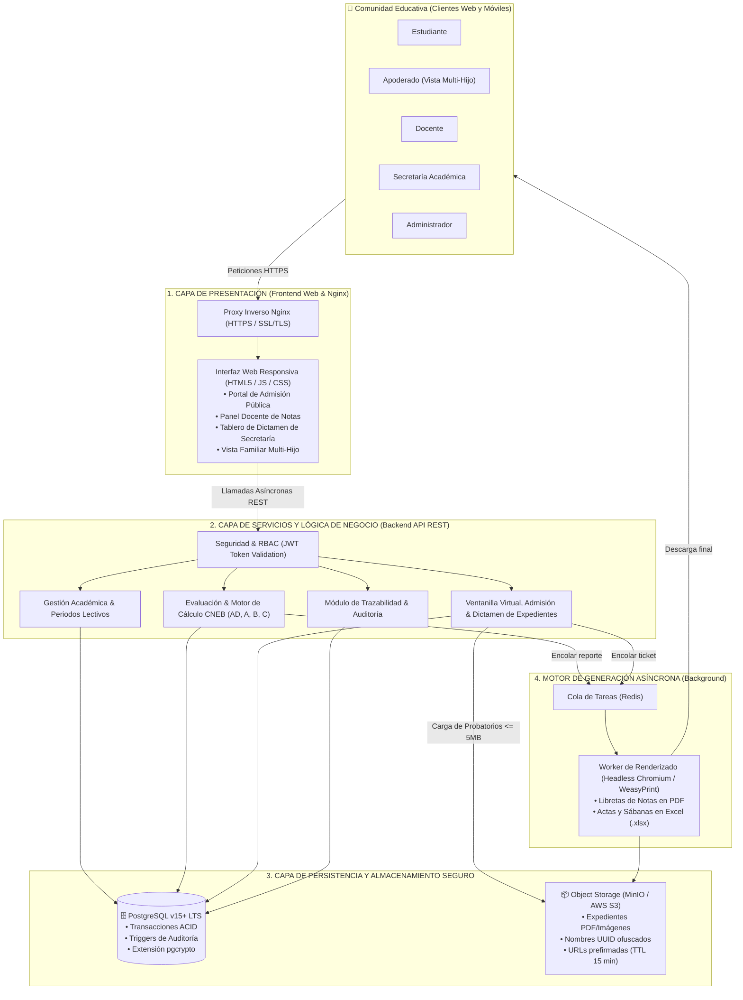

# Propuesta de Arquitectura en Capas Inicial: Portal de Servicios Estudiantiles

A continuación se presenta la propuesta de arquitectura organizada en capas según los módulos, actores y flujos identificados en el análisis del sistema escolar:

---

## 1. Organización de Capas y Responsabilidades

| Capa | Pregunta que responde | Responsabilidades y Módulos |
| :--- | :--- | :--- |
| **Presentación** | ¿Cómo interactúa la comunidad escolar? | • **Interfaz Web Responsiva (Frontend):** Vistas para Alumnos, Docentes, Secretaría, Administradores y Vista Familiar Multi-Hijo para Apoderados. • **Ventanilla Virtual Pública:** Formulario de admisión, traslados y consulta de estado por ticket. • **API Gateway / Proxy Inverso:** Nginx gestionando terminación SSL/TLS (HTTPS) y balanceo perimetral. |
| **Servicios y Lógica de Negocio** | ¿Qué hace el sistema escolar? | Módulos encargados de orquestar las reglas del negocio educativo: • **Seguridad y RBAC:** Autenticación JWT, verificación de roles y aislamiento de accesos. • **Gestión Académica:** Catálogo escolar, asignación docente y máquina de estados de periodos lectivos. • **Evaluación y Calificaciones:** Cuadrícula de captura masiva, motor de cálculo CNEB (AD, A, B, C y vigesimal) y validación previa de cierre. • **Ventanilla Virtual y Dictamen:** Recepción de solicitudes, emisión de tickets únicos, bandeja de secretaría y generación de pre-matrículas. • **Auditoría:** Registro de trazabilidad para cambios de notas y estados. |
| **Persistencia de Datos e Integridad** | ¿Dónde se almacena la información estructurada? | • **Base de Datos Relacional (PostgreSQL v15+):** Almacenamiento seguro del modelo escolar, tablas de auditoría, constraints de clave foránea y transacciones ACID. • **Extensión pgcrypto:** Cifrado y hashing seguro de credenciales. |
| **Almacenamiento Documental y Workers** | ¿Dónde se custodian los probatorios y compilan reportes? | • **Object Storage Seguro (MinIO / S3):** Custodia de expedientes probatorios (DNI, partidas, certificados) con UUIDs y URLs prefirmadas (TTL 15 min). • **Motor de Tareas en Background (Redis + Worker):** Procesamiento asíncrono para la compilación de libretas de notas oficiales en PDF y actas en Excel compatibles con SIAGIE. |

---

## 2. Diagrama Estructural de la Arquitectura en Capas

---

## 3. Descripción de Componentes e Integraciones

* **Capa de Presentación:** Atiende a los cinco roles mediante vistas altamente responsivas y desacopladas del servidor central a través de Nginx como terminador SSL/TLS y proxy inverso.
* **Capa de Lógica de Negocio:** Expone una **API RESTful** segura. Encapsula las reglas del Ministerio de Educación (escala CNEB, ponderaciones, periodos lectivos y bloqueo de notas extemporáneas), el control RBAC y la emisión automática de tickets de expedientes.
* **Capa de Persistencia de Datos:** Gestiona la integridad referencial y las transacciones escolares en PostgreSQL. Dispone de triggers de base de datos para garantizar auditoría inalterable de cada calificación ingresada o modificada.
* **Almacenamiento Documental Seguro:** Aísla los documentos sensibles de menores de edad en MinIO / AWS S3 bajo cifrado AES-256, restringiendo el acceso únicamente mediante URLs prefirmadas de corta duración (TTL 15 minutos).
* **Integración y Compatibilidad SIAGIE:** Al estar fuera de alcance una conexión API directa por disposición ministerial, el sistema provee una exportación de sábanas y actas en Excel (.xlsx) estructuradas idénticamente al formato oficial para la carga o transcripción manual en secretaría.
