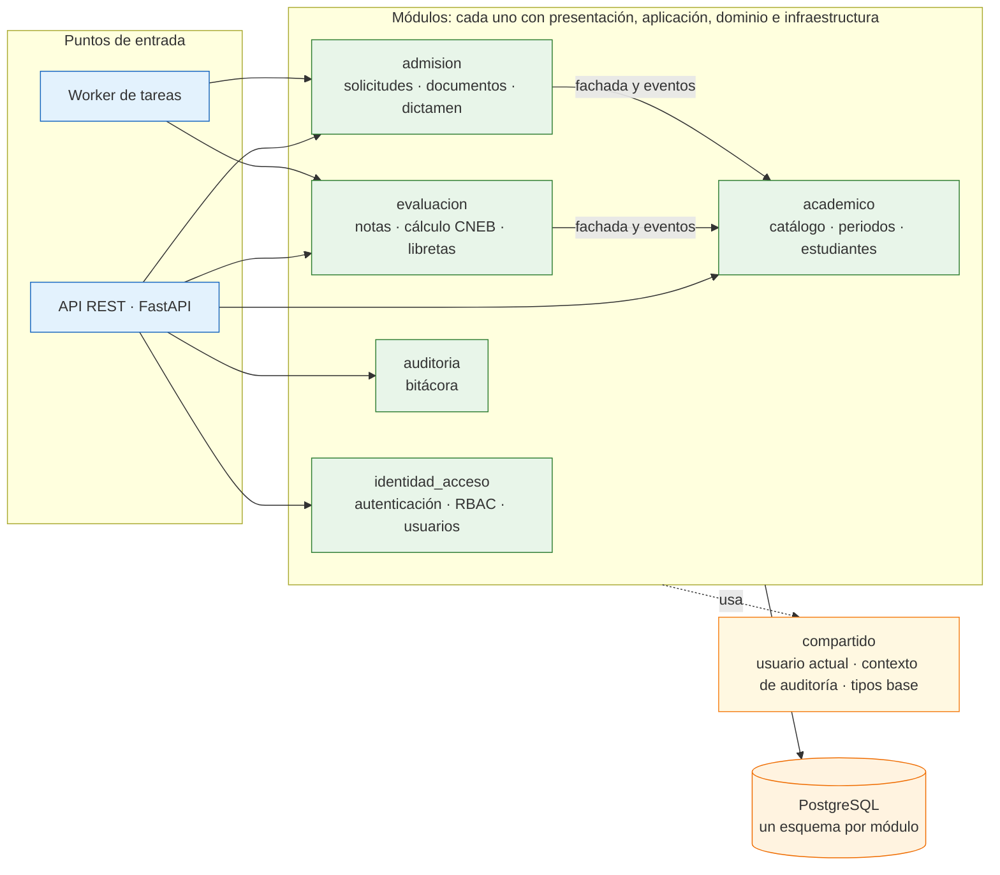

# Propuesta de Arquitectura Inicial: Portal de Servicios Estudiantiles

Esta es la vista **lógica y modular** del sistema: qué módulos existen, qué requisitos cubre cada uno, cómo dependen entre sí y cómo fluyen las operaciones críticas durante los picos. El despliegue está en [estilo-arquitectonico.md](estilo-arquitectonico.md) y la organización interna de cada módulo (arquitectura limpia) en [enfoque/enfoque-arquitectonico.md](enfoque/enfoque-arquitectonico.md).

---

## 1. Organización de Capas y Responsabilidades

| Capa | Pregunta que responde | Responsabilidades y componentes |
| :--- | :--- | :--- |
| **Presentación** | ¿Cómo interactúa la comunidad escolar? | • **SPA responsiva:** vistas para Estudiantes, Docentes, Secretaría, Administradores y la Vista Familiar Multi-Hijo para Apoderados. • **Ventanilla Virtual Pública:** formulario de admisión, traslados y consulta de estado por ticket. • **Proxy inverso Nginx:** terminación TLS (HTTPS), balanceo entre las instancias de la API, SPA estática y límites de tasa en rutas públicas. |
| **Servicios y lógica de negocio** | ¿Qué hace el sistema escolar? | Monolito modular (API REST y worker) con cinco módulos que orquestan las reglas del negocio educativo: **identidad_acceso**, **academico**, **evaluacion**, **admision** y **auditoria** (ver sección 2). |
| **Persistencia y almacenamiento seguro** | ¿Dónde se guarda y se consulta la información? | • **PostgreSQL 16+:** modelo escolar con un esquema por módulo, tablas de auditoría con triggers, claves foráneas y transacciones ACID. • **Redis de caché:** lecturas calientes (vista familiar y calificaciones confirmadas). • **Object Storage seguro (MinIO / S3):** expedientes probatorios y libretas con nombres UUID, cifrado en reposo y URLs prefirmadas (TTL 15 min). |
| **Procesamiento asíncrono** | ¿Dónde se compilan los documentos pesados? | **Redis de cola y worker Python:** libretas PDF (WeasyPrint), actas y sábanas Excel (openpyxl) y verificación de documentos subidos, sin afectar la atención de peticiones. |

---

## 2. Módulos y Reglas de Modularidad

Cada requisito funcional tiene un único módulo propietario. Los cinco módulos se despliegan juntos (un solo monolito) pero se mantienen con fronteras explícitas.

| Módulo | Responsabilidad | Requisitos funcionales |
| :--- | :--- | :--- |
| `identidad_acceso` | Autenticación, RBAC, usuarios y credenciales | RF14 |
| `academico` | Catálogo escolar, periodos lectivos, asignación docente, estudiantes y vínculo apoderado–estudiante, legajo | RF02, RF03, RF04, RF05 |
| `evaluacion` | Cuadrícula de notas, cálculo CNEB, confirmación, vista familiar, libretas y actas | RF01, RF06, RF07, RF08, RF15, RF16 |
| `admision` | Preinscripción, traslados, documentos probatorios, dictamen, ticket y reportes de control | RF09, RF10, RF11, RF12, RF13, RF17 |
| `auditoria` | Bitácora de auditoría (los triggers registran; el módulo consulta) | RF18 |

**Reglas de modularidad:**
1. Un módulo solo se usa a través de su **fachada** (capa de aplicación); nunca se importan el dominio, los repositorios ni las tablas de otro módulo.
2. Dependencias permitidas: `evaluacion → academico` y `admision → academico`, sin ciclos. El resto de módulos no depende de ninguno. Todos usan `compartido` (usuario actual, contexto de auditoría y tipos base, sin reglas de negocio).
3. Los efectos entre módulos viajan como **eventos de dominio en proceso** (`PeriodoConsolidado`, `SolicitudAprobada`, `NotasConfirmadas`), no como tablas compartidas.
4. Cada módulo es dueño de su esquema PostgreSQL; las claves foráneas entre esquemas solo apuntan al módulo del que se depende.

---

## 3. Diagrama de la Vista Modular (Mermaid)

La API y el worker son puntos de entrada de la misma base de código: ambos ejecutan casos de uso de los módulos, de modo que las reglas del cálculo CNEB no se duplican.

---

## 4. Flujos Críticos en Pico

### 4.1. Consulta de calificaciones (publicación de notas)
Es el flujo más frecuente: miles de apoderados consultan notas casi a la vez. La autorización (rol y propiedad apoderado–hijo) se evalúa siempre antes de leer la caché, y la base de datos solo recibe los fallos de caché.

### 4.2. Libretas pre-generadas (consolidación del periodo)
Al consolidar el periodo se generan las libretas en segundo plano, de modo que el pico de descargas sea lectura de archivos y no cómputo de PDF. La generación bajo demanda queda como respaldo.

### 4.3. Subida de probatorios (campaña de admisión)
Los archivos viajan directamente del navegador al storage; la API no maneja bytes de archivos. El límite de 5 MB y los tipos permitidos se fijan en la política prefirmada y el worker verifica el tipo real por el contenido.

---

## 5. Integración y Compatibilidad SIAGIE
Por decisión de alcance del MVP (RC06) no existe una conexión API directa con SIAGIE. El sistema exporta sábanas y actas en Excel (.xlsx) con la estructura de la plantilla oficial vigente para que Secretaría las cargue o transcriba manualmente.
