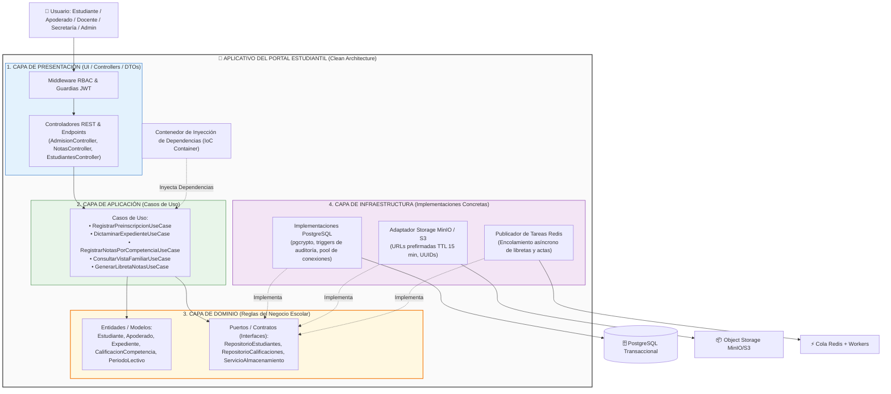

# Enfoque Arquitectónico del Sistema: Clean Architecture (Arquitectura Limpia)

## 1. Información General

| Elemento | Descripción aplicada al Portal de Servicios Estudiantiles |
| :--- | :--- |
| **Patrón / Enfoque Arquitectónico** | Clean Architecture (Arquitectura Limpia) |
| **Objetivo Principal** | Separar las responsabilidades del negocio educativo y controlar que las dependencias internas apunten siempre hacia el Dominio escolar. |
| **¿Qué problema resuelve?** | Evita el acoplamiento rígido entre las interfaces visuales web, las reglas pedagógicas del CNEB (escalas AD, A, B, C, promedios, cierre de actas) y las tecnologías externas (PostgreSQL, APIs REST, almacenamiento MinIO/S3, colas Redis). |
| **Capas Definidas** | Presentación, Aplicación, Dominio e Infraestructura. |
| **Beneficios** | • Facilita el mantenimiento y la realización de pruebas unitarias sobre las reglas de evaluación. • Permite cambiar tecnologías externas (como migrar de MinIO local a AWS S3) sin tocar el núcleo de negocio. • Mejora la organización y modularidad, asegurando el cumplimiento del horizonte de entrega de 3 meses. |

---

## 2. Definición de Capas y Responsabilidades

En Clean Architecture, el código se organiza en círculos concéntricos. **La regla de oro de la dependencia establece que las dependencias deben apuntar únicamente hacia adentro**, garantizando que el Dominio no dependa de ningún framework ni librería de infraestructura.

### 2.1. Capa de Dominio (`src/app/domain`)
Es el núcleo central de la aplicación y contiene la lógica pura e invariable del negocio escolar:
* **Entidades (Models):** Objetos de negocio con validaciones intrínsecas (ej. `Estudiante`, `Apoderado`, `ExpedienteAdmision`, `CalificacionCompetencia`, `PeriodoLectivo`, `CursoSeccion`).
* **Contratos / Puertos (Interfaces):** Define lo que el dominio requiere del exterior sin conocer su implementación técnica (ej. `RepositorioEstudiantes`, `RepositorioExpedientes`, `RepositorioCalificaciones`, `ServicioAlmacenamientoDocumental`, `ServicioNotificacion`).

### 2.2. Capa de Aplicación (`src/app/application`)
Contiene los casos de uso específicos del Portal Escolar de la I.E. Emblemática Mariscal Cáceres. Coordina el flujo de datos desde y hacia el dominio:
* **Casos de Uso (Use Cases):** Encapsulan las operaciones del sistema (ej. `RegistrarPreinscripcionUseCase`, `DictaminarExpedienteUseCase`, `RegistrarNotasPorCompetenciaUseCase`, `CerrarPeriodoLectivoUseCase`, `ConsultarVistaFamiliarUseCase`, `GenerarLibretaNotasUseCase`).

### 2.3. Capa de Presentación / Adaptadores (`src/app/presentation`)
Contiene los controladores de la API REST, interceptores y componentes con los que interactúan los usuarios:
* **Controladores REST y DTOs:** `AdmisionController`, `CalificacionesController`, `PeriodosController`, `EstudiantesController`.
* **Middlewares y Vistas:** Validación de esquemas, middleware de autorización RBAC (tokens JWT) y controladores de vistas responsivas.

### 2.4. Capa de Infraestructura (`src/app/infrastructure`)
Contiene las implementaciones técnicas concretas y las comunicaciones con el exterior:
* **Repositorios e Implementaciones de Persistencia:** `RepositorioEstudiantesPostgres`, `RepositorioCalificacionesPostgres`.
* **Adaptadores de Servicios Externos:** `ServicioAlmacenamientoMinIO`, `PublicadorColasRedis`, `GeneradorReportesWorker`.
* **Configuraciones Técnicas:** Conexión a la base de datos PostgreSQL con transacciones ACID y triggers de auditoría.

---

## 3. Diagrama de Enfoque Arquitectónico (Mermaid)

