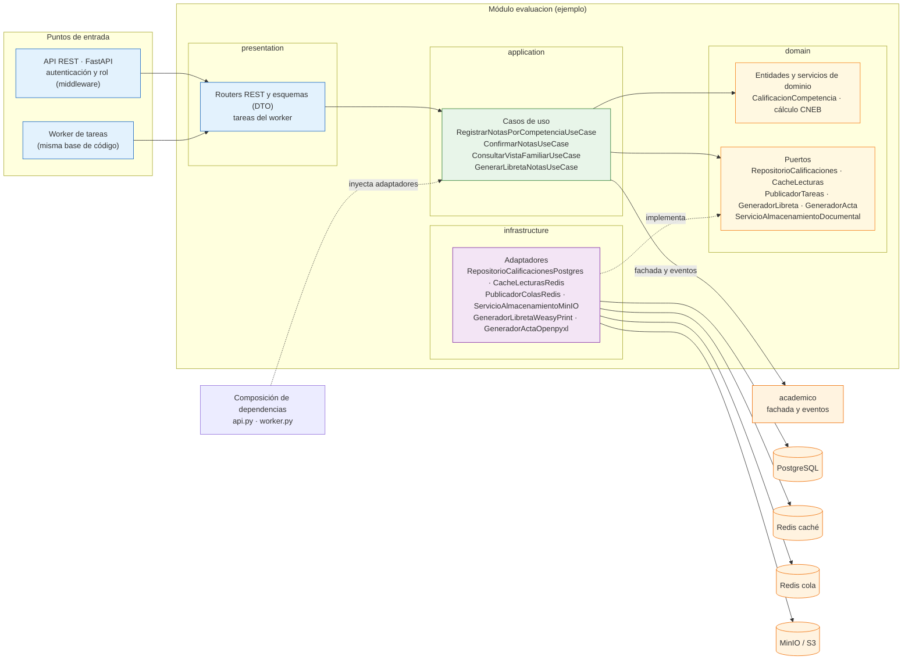

# Enfoque Arquitectónico del Sistema: Clean Architecture (Arquitectura Limpia)

Este documento describe la organización **interna** del backend: cada módulo (ver [arquitectura-inicial.md](../arquitectura-inicial.md)) aplica Clean Architecture y todos se despliegan según [estilo-arquitectonico.md](../estilo-arquitectonico.md). La decisión está registrada en ADR-008 de [07-Decisiones-arquitectonicas.md](../../Analisis-de-sistema/07-Decisiones-arquitectonicas.md).

## 1. Información General

| Elemento | Descripción aplicada al Portal de Servicios Estudiantiles |
| :--- | :--- |
| **Patrón / Enfoque Arquitectónico** | Clean Architecture (Arquitectura Limpia) aplicada por módulo dentro de un monolito modular |
| **Objetivo Principal** | Separar las responsabilidades del negocio educativo y controlar que las dependencias internas de cada módulo apunten siempre hacia su Dominio. |
| **¿Qué problema resuelve?** | Evita el acoplamiento rígido entre la API REST, las reglas pedagógicas del CNEB (escalas AD, A, B, C, promedios, cierre de actas) y las tecnologías externas (PostgreSQL, almacenamiento MinIO/S3, Redis, WeasyPrint y openpyxl). |
| **Capas Definidas** | Presentación, Aplicación, Dominio e Infraestructura (dentro de cada módulo). |
| **Beneficios** | • Las reglas de evaluación se prueban sin base de datos ni red. • Cambiar la cola, el motor de PDF/Excel o el almacenamiento toca solo un adaptador de infraestructura. • La API y el worker reutilizan los mismos casos de uso, por lo que el cálculo CNEB no se duplica. • La complejidad se mantiene acotada: un solo despliegue y capas completas solo donde hay lógica de negocio (evaluación y admisión); los módulos de CRUD simple pueden usar capas delgadas. |

---

## 2. Estructura Modular

El backend es un monolito modular en Python; este árbol es solo el del backend. La SPA vive aparte y consume la API REST (RC03). Cada módulo tiene las mismas cuatro carpetas que `evaluacion`, que se muestra completo como ejemplo.

**Regla de la dependencia (dentro de cada módulo):** presentación → aplicación → dominio ← infraestructura. El Dominio no importa frameworks ni librerías de infraestructura; los puertos (interfaces) viven en el Dominio y los adaptadores concretos en Infraestructura. Entre módulos solo se permiten las dependencias y los eventos de dominio descritos en las reglas de modularidad de [arquitectura-inicial.md](../arquitectura-inicial.md).

---

## 3. Capas y Responsabilidades (dentro de cada módulo)

### 3.1. Capa de Dominio (`domain`)
Es el núcleo del módulo y contiene la lógica pura e invariable del negocio escolar:
* **Entidades y objetos de valor** con validaciones intrínsecas (ej. `Estudiante`, `Apoderado`, `PeriodoLectivo` y `CursoSeccion` en `academico`; `CalificacionCompetencia` en `evaluacion`; `ExpedienteAdmision` en `admision`).
* **Servicios de dominio:** el cálculo CNEB (escalas AD, A, B, C y vigesimal, y promedios) vive en `evaluacion`.
* **Puertos (interfaces):** lo que el dominio requiere del exterior sin conocer su implementación: `RepositorioEstudiantes`, `RepositorioExpedientes`, `RepositorioCalificaciones`, `ServicioAlmacenamientoDocumental`, `CacheLecturas`, `PublicadorTareas`, `GeneradorLibreta` y `GeneradorActa`. `ServicioNotificacion` queda previsto para después del MVP, porque ningún requisito lo exige todavía.

### 3.2. Capa de Aplicación (`application`)
Contiene los casos de uso del Portal Escolar de la I.E. Emblemática Mariscal Cáceres y la **fachada pública** del módulo, que es lo único que otros módulos pueden usar. Los casos de uso publican eventos de dominio (`NotasConfirmadas`, `PeriodoConsolidado`, `SolicitudAprobada`) que otros módulos o la infraestructura (por ejemplo, para invalidar la caché) consumen en proceso.

| Módulo | Casos de uso (ejemplos) |
| :--- | :--- |
| `identidad_acceso` | `IniciarSesionUseCase`, `RenovarSesionUseCase` |
| `academico` | `CambiarEstadoPeriodoUseCase`, `ObtenerHijosDeApoderadoUseCase` |
| `evaluacion` | `RegistrarNotasPorCompetenciaUseCase`, `ConfirmarNotasUseCase`, `ConsultarVistaFamiliarUseCase`, `GenerarLibretaNotasUseCase` |
| `admision` | `RegistrarPreinscripcionUseCase`, `SolicitarSubidaDocumentoUseCase`, `ConfirmarSubidaDocumentoUseCase`, `DictaminarExpedienteUseCase` |
| `auditoria` | `ConsultarBitacoraUseCase` |

### 3.3. Capa de Presentación (`presentation`)
Es la entrada de cada módulo y no contiene reglas de negocio:
* **Controladores REST y DTOs** (routers de FastAPI): `AdmisionController`, `CalificacionesController`, `PeriodosController`, `EstudiantesController`.
* **Middleware de autenticación y autorización por rol** (tokens JWT y RBAC) y validación de esquemas.
* **Tareas del worker:** invocan los mismos casos de uso (generar libretas y actas, verificar documentos subidos).
* No hay vistas: la interfaz es una SPA separada que consume la API REST.

### 3.4. Capa de Infraestructura (`infrastructure`)
Contiene las implementaciones técnicas concretas y las comunicaciones con el exterior:
* **Repositorios:** `RepositorioEstudiantesPostgres`, `RepositorioExpedientesPostgres`, `RepositorioCalificacionesPostgres`.
* **Adaptadores de servicios externos:** `ServicioAlmacenamientoMinIO` (URLs prefirmadas), `CacheLecturasRedis`, `PublicadorColasRedis`, `GeneradorLibretaWeasyPrint` y `GeneradorActaOpenpyxl`.
* **Configuración técnica:** conexión a PostgreSQL con pool acotado, transacciones ACID y triggers de auditoría (como migraciones).

La composición de dependencias ocurre en los puntos de entrada `api.py` y `worker.py`, que crean los adaptadores y los inyectan en los casos de uso.

---

## 4 Diagrama de Enfoque Arquitectónico (Mermaid)

El diagrama muestra el módulo `evaluacion` como ejemplo; los demás módulos siguen la misma estructura.

