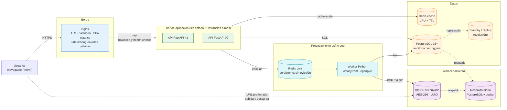

# Estilo Arquitectónico del Sistema: Portal de Servicios Estudiantiles (MVP)

## 1. Descripción General
Se optó por una arquitectura **N-Tier (multicapa) desacoplada**, desplegada en contenedores, con un tier de aplicación sin estado y servicios de soporte especializados. Este documento describe la vista de **despliegue** (qué se ejecuta y cómo escala). La estructura **modular** del backend está en [arquitectura-inicial.md](arquitectura-inicial.md) y la organización interna **limpia** de cada módulo en [enfoque/enfoque-arquitectonico.md](enfoque/enfoque-arquitectonico.md). Las decisiones se registran en [07-Decisiones-arquitectonicas.md](../Analisis-de-sistema/07-Decisiones-arquitectonicas.md).

- **Presentación:** SPA responsiva (HTML5, JS y CSS) servida como archivos estáticos por Nginx.
- **Aplicación:** API REST en Python 3.12+ (soporte hasta oct-2028) con FastAPI, sin estado de sesión (JWT) y con al menos 2 instancias detrás de Nginx.
- **Datos:** PostgreSQL 16+ (transacciones ACID y triggers de auditoría), Redis de caché y almacenamiento de objetos MinIO/S3 privado.
- **Procesamiento asíncrono:** cola Redis y worker Python (WeasyPrint para PDF y openpyxl para .xlsx) que comparten la base de código de la API.
- **Borde:** Nginx es el único componente expuesto a Internet: termina TLS (HTTPS obligatorio), balancea entre las instancias de la API, sirve la SPA y aplica límites de tasa en las rutas públicas. PostgreSQL, Redis y el worker solo son accesibles desde la red interna; el storage se alcanza únicamente con URLs prefirmadas.
- **Unidad de despliegue:** una sola base de código backend (monolito modular) que se ejecuta como API y como worker, orquestada con Docker Compose. Es viable dentro de las 12 semanas del MVP.

---

## 2. Diagrama de Despliegue (Mermaid)

El navegador sube y descarga documentos directamente del storage con URLs prefirmadas (línea punteada). El storage se publica en un subdominio propio, detrás de Nginx y preservando el encabezado `Host`, para que la firma de la URL sea válida. La standby/réplica es evolución y no se construye en el MVP; el respaldo diario sí forma parte del MVP.

---

## 3 Tácticas por Atributo de Calidad

| Atributo | Táctica | Componente en el diagrama | Decisión |
|---|---|---|---|
| AC01 Rendimiento | Caché cache-aside, endpoint agregado, índices y pre-generación de libretas | Redis caché, API FastAPI, PostgreSQL, Worker | ADR-006, ADR-003 |
| AC02 Disponibilidad | 2 instancias de API con health checks y respaldo diario con restauración probada | Nginx, API FastAPI #1 y #2, Respaldo diario | ADR-007 |
| AC03 Escalabilidad | API sin estado; cola y worker para la carga pesada | API FastAPI, Redis cola, Worker | ADR-001, ADR-003, ADR-004 |
| AC04 Seguridad y Privacidad | TLS en el borde, RBAC y propiedad, bucket privado con URLs prefirmadas, cifrado en reposo y límites de tasa en rutas públicas | Nginx, API FastAPI, MinIO / S3 | ADR-002, ADR-004 |
| AC05 Integridad y Trazabilidad | Transacciones ACID y triggers de auditoría con usuario e IP por transacción | PostgreSQL | ADR-005 |
| AC06 Mantenibilidad | Monolito modular con Clean Architecture por módulo y adaptadores intercambiables | API FastAPI y Worker (misma base de código) | ADR-008 |

---

## 4 MVP, Evolución y Riesgos Aceptados

- **MVP (12 semanas):** todo lo del diagrama, excepto la standby/réplica.
- **Evolución:** standby o réplica de lectura de PostgreSQL, PgBouncer cuando las conexiones superen unas 100, CDN para los estáticos, segundo nodo con balanceador, captcha ante abuso en las rutas públicas, antivirus en las subidas y hash encadenado en la bitácora de auditoría.
- **Riesgos aceptados:** el servidor único es punto único de falla (se mitiga con respaldo diario y restauración probada; RTO de hasta 2 h) y las calificaciones en caché pueden estar desfasadas hasta 60 s.
