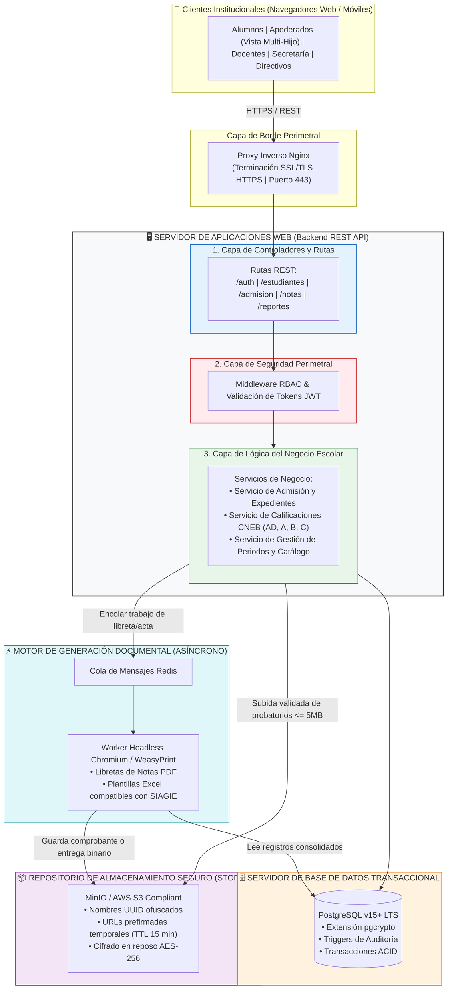

# Estilo Arquitectónico del Sistema: Portal de Servicios Estudiantiles (MVP)

## 1. Descripción General
En este documento se define el estilo arquitectónico seleccionado para el proyecto Portal de Servicios Estudiantiles de la I.E. Emblemática Mariscal Cáceres. Se optó por una arquitectura **N-Tier (Multicapa) Desacoplada y Distribuida** con servicios de soporte especializados:

- **Organización lógica:** Basada en capas independientes (Presentación Web, Lógica de Negocio/APIs REST, Persistencia Transaccional, Almacenamiento Seguro de Objetos y Procesamiento en Background).
- **Unidad de despliegue del núcleo:** Un servicio de backend en Node.js v18+ LTS (o Python FastAPI) alojado tras un proxy inverso Nginx con HTTPS/TLS obligatorio, simplificando la infraestructura y asegurando un despliegue viable en el horizonte estipulado de 3 meses (12 semanas).
- **Aislamiento de cargas pesadas:** Desacoplamiento de la compilación de documentos mediante cola Redis y worker dedicado, evitando caídas o degradación de rendimiento durante el cierre masivo de bimestres.

---

## 2. Diagrama de Arquitectura (Mermaid)

