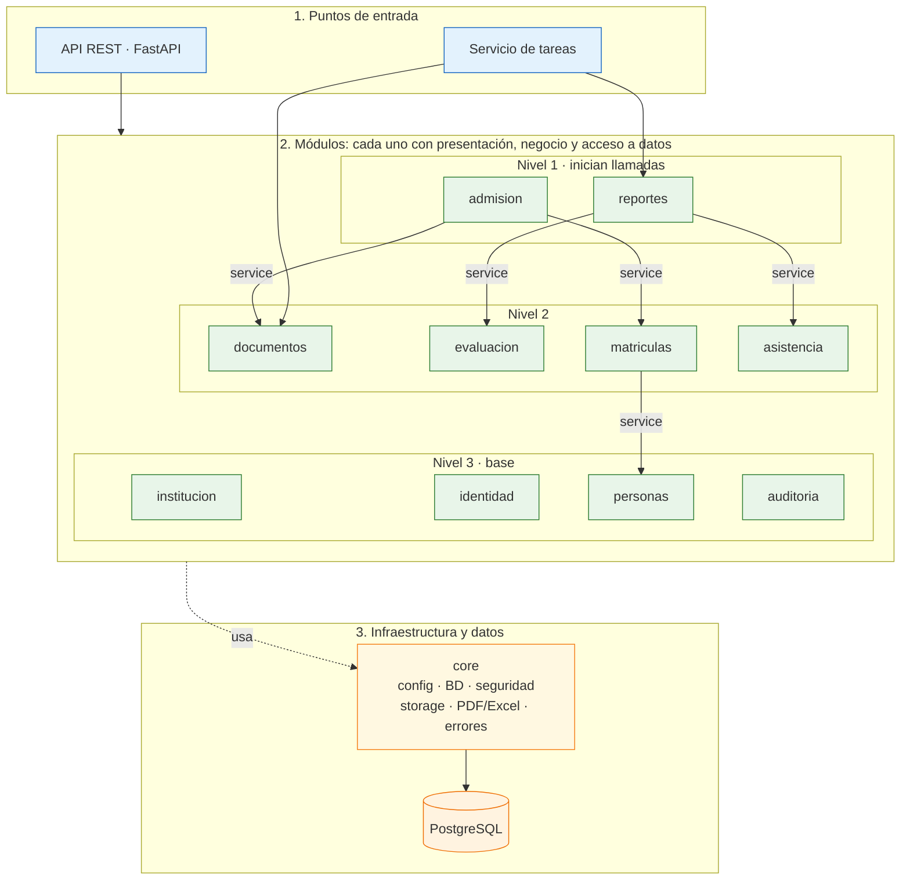

# Propuesta de Arquitectura Inicial: Portal de Servicios Estudiantiles

Esta es la vista **lógica y modular** del sistema: qué módulos existen, qué requisitos cubre cada uno, cómo dependen entre sí y cómo fluyen las operaciones críticas durante los picos. El despliegue está en [estilo-arquitectonico.md](estilo-arquitectonico.md) y la organización interna de cada módulo (capas estrictas) en [enfoque-arquitectonico.md](enfoque-arquitectonico.md).

---

## 1. Organización de Capas y Responsabilidades

| Capa | Pregunta que responde | Responsabilidades y componentes |
| :--- | :--- | :--- |
| **Presentación** | ¿Cómo interactúa la comunidad escolar? | • **SPA responsiva (React + TypeScript):** vistas para Estudiantes, Docentes, Secretaría, Administradores y la Vista Familiar Multi-Hijo para Apoderados. • **Ventanilla Virtual Pública:** formulario de admisión, traslados y consulta de estado por ticket. • **Firebase Hosting:** SPA estática y redirección de `/api/**` a la API. |
| **Servicios y lógica de negocio** | ¿Qué hace el sistema escolar? | Monolito modular (API REST y servicio de tareas) con diez módulos que orquestan las reglas del negocio educativo (ver sección 2). |
| **Persistencia y almacenamiento seguro** | ¿Dónde se guarda y se consulta la información? | • **PostgreSQL 16+ (Cloud SQL):** modelo escolar, bitácora de auditoría, claves foráneas, transacciones ACID y tabla de notas consolidadas. • **Cloud Storage:** expedientes probatorios y libretas con nombres UUID, cifrado en reposo y URLs firmadas (TTL 15 min). |
| **Procesamiento asíncrono** | ¿Dónde se compilan los documentos pesados? | **Cloud Tasks y servicio de tareas:** libretas PDF (WeasyPrint), actas y sábanas Excel (openpyxl) y verificación de documentos subidos, sin afectar la atención de peticiones. |

---

## 2. Módulos y Reglas de Modularidad

Cada requisito funcional tiene un único módulo propietario. Los diez módulos se despliegan juntos (un solo monolito) pero se mantienen con fronteras explícitas.

| Módulo | Responsabilidad | Requisitos funcionales |
| :--- | :--- | :--- |
| `identidad` | Autenticación, RBAC, usuarios y credenciales | RF14 |
| `institucion` | Catálogo escolar, periodos lectivos y asignación docente | RF03, RF04, RF05 |
| `personas` | Estudiantes, apoderados, docentes y vínculo apoderado–estudiante | RF01 |
| `matriculas` | Matrícula y pre-matrícula (bisagra entre admisión y vida académica), legajo | RF02 |
| `admision` | Preinscripción, traslados, ticket y dictamen | RF09, RF10, RF11, RF13 |
| `documentos` | Mesa de partes: subida y descarga de probatorios | RF12 |
| `evaluacion` | Cuadrícula de notas, cálculo CNEB y confirmación | RF06, RF07, RF08 |
| `asistencia` | Registro y consulta de asistencia diaria | RF19, RF20 |
| `reportes` | Libretas, actas, cuadros de mérito y reportes de control | RF15, RF16, RF17 |
| `auditoria` | Bitácora de auditoría (los services registran; el módulo consulta) | RF18 |

**Reglas de modularidad:**
1. Un módulo solo llama al `service` de otro; nunca a su repositorio ni a sus tablas.
2. Las llamadas entre módulos comparten la transacción de la petición: al aprobar un expediente, `admision` llama a `matriculas.service.crear_matricula()` y, si la matrícula falla, la aprobación se revierte.
3. `reportes` lee de `evaluacion` y `asistencia` a través de sus services.
4. Las dependencias no forman ciclos; la matriz completa se define junto con el modelo de datos.

---

## 3. Diagrama de la Vista Modular (Mermaid)

La API y el servicio de tareas son puntos de entrada de la misma base de código, de modo que las reglas del cálculo CNEB no se duplican. Solo `core/` habla con los servicios de Google Cloud.

Los niveles ordenan las llamadas `service` a `service` dibujadas: cada módulo solo llama a los de niveles inferiores. `institucion`, `identidad` y `auditoria` no tienen llamadas dibujadas todavía y se ubican en la base hasta que se defina la matriz completa de dependencias.

---

## 4. Flujos Críticos en Pico

### 4.1. Consulta de calificaciones (publicación de notas)
Es el flujo más frecuente: miles de apoderados consultan notas casi a la vez. La autorización (rol y pertenencia apoderado–hijo) se evalúa en cada petición y la lectura sale de la tabla de notas consolidadas precalculada al cerrar el periodo, con índices por estudiante y periodo.

### 4.2. Libretas pre-generadas (consolidación del periodo)
Al consolidar el periodo se encola en Cloud Tasks un lote por sección, de modo que el pico de descargas sea lectura de archivos y no cómputo de PDF. La libreta de un solo alumno se genera de forma síncrona.

### 4.3. Subida de probatorios (campaña de admisión)
Los archivos viajan directamente del navegador a Cloud Storage; la API no maneja bytes de archivos. El límite de 5 MB y los tipos permitidos se fijan en la política de subida firmada y una tarea verifica el tipo real por el contenido.

---

## 5. Integración y Compatibilidad SIAGIE
Por decisión de alcance del MVP (RC06) no existe una conexión API directa con SIAGIE. El sistema exporta sábanas y actas en Excel (.xlsx) con la estructura de la plantilla oficial vigente para que Secretaría las cargue o transcriba manualmente.
