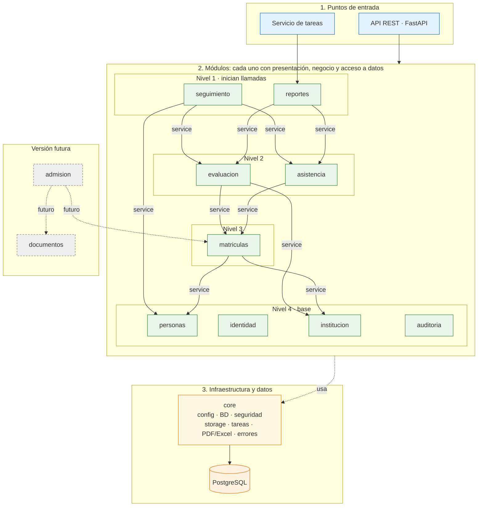

# Propuesta de Arquitectura Inicial: Portal de Servicios Estudiantiles

Esta es la vista **lógica y modular** del sistema: qué módulos existen, qué requisitos cubre cada uno, cómo dependen entre sí y cómo fluyen las operaciones críticas. El despliegue está en [estilo-arquitectonico.md](estilo-arquitectonico.md) y la organización interna de cada módulo (capas estrictas) en [enfoque-arquitectonico.md](enfoque-arquitectonico.md).

---

## 1. Organización de Capas y Responsabilidades

| Capa | Pregunta que responde | Responsabilidades y componentes |
| :--- | :--- | :--- |
| **Presentación** | ¿Cómo interactúa la comunidad escolar? | • **SPA responsiva (React + TypeScript):** vista de seguimiento para apoderados y estudiantes, cuadrícula móvil para docentes y auxiliares, y vistas para Secretaría, Dirección y Administrador. • **Firebase Hosting:** SPA estática y redirección de `/api/**` a la API. |
| **Servicios y lógica de negocio** | ¿Qué hace el sistema escolar? | Monolito modular (API REST y servicio de tareas) con nueve módulos activos en el MVP y dos diferidos (ver sección 2). |
| **Persistencia y almacenamiento seguro** | ¿Dónde se guarda y se consulta la información? | • **PostgreSQL 16+ (Cloud SQL):** modelo escolar, actividades, niveles, asistencia, bitácora de auditoría, claves foráneas y transacciones ACID. • **Cloud Storage:** libretas y actas con nombres UUID, cifrado en reposo y URLs firmadas (TTL 15 min). |
| **Procesamiento asíncrono** | ¿Dónde se compilan los documentos pesados? | **Cloud Tasks y servicio de tareas:** libretas PDF (WeasyPrint) y actas y Excel SIAGIE (openpyxl), sin afectar la atención de peticiones. |

---

## 2. Módulos y Reglas de Modularidad

Cada requisito funcional tiene un único módulo propietario. Los módulos se despliegan juntos (un solo monolito) pero se mantienen con fronteras explícitas.

| Módulo | Responsabilidad | Requisitos funcionales | Estado |
| :--- | :--- | :--- | :--- |
| `seguimiento` | Vista continua de apoderados, estudiantes y sección. Compone lecturas de otros módulos; no tiene tablas propias salvo la marca de última visita | RF01, RF26, RF31 | MVP |
| `reportes` | Libretas, Excel SIAGIE, actas preliminares y publicación de libretas | RF15, RF16, RF27 | MVP |
| `evaluacion` | Actividades, resultados, observaciones, mensajes, niveles del trimestre, conclusiones, cierres y reapertura | RF06, RF07, RF08, RF22, RF23, RF24, RF25, RF28, RF30 | MVP |
| `asistencia` | Registro y consulta de asistencia diaria | RF19, RF20 | MVP |
| `matriculas` | Nómina vigente, asignación a sección y estado del estudiante | RF21 | MVP |
| `institucion` | Catálogo escolar (incluidas asignaturas y competencias), años, trimestres y asignación de docentes, tutores y auxiliares | RF03, RF04, RF05 | MVP |
| `personas` | Estudiantes, apoderados, personal y vínculo apoderado–estudiante | Datos de RF01 y RF21 | MVP |
| `identidad` | Autenticación, RBAC, usuarios, activación y credenciales | RF14 | MVP |
| `auditoria` | Bitácora y registro de accesos (los services registran; el módulo consulta) | RF18, RF29 | MVP |
| `admision` | Preinscripción, traslados, ticket y dictamen | RF09, RF10, RF11, RF13 | Versión futura |
| `documentos` | Mesa de partes: subida y descarga de probatorios | RF12 | Versión futura |

RF02 y RF17 también quedan pospuestos, en `matriculas` y `reportes`.

**Reglas de modularidad:**
1. Un módulo solo llama al `service` de otro; nunca a su repositorio ni a sus tablas.
2. Las llamadas entre módulos comparten la transacción de la petición.
3. `seguimiento` y `reportes` leen de `evaluacion` y `asistencia` a través de sus services.
4. Las dependencias no forman ciclos; cada módulo solo llama a los de niveles inferiores.
5. El cierre del trimestre lo orquesta `evaluacion`, que pide el cambio de estado a `institucion` y encola las libretas por `core/`, sin importar `reportes` (ADR-009).

---

## 3. Diagrama de la Vista Modular (Mermaid)

La API y el servicio de tareas son puntos de entrada de la misma base de código, de modo que las reglas de evaluación no se duplican. Solo `core/` habla con los servicios de Google Cloud.

Los niveles ordenan las llamadas `service` a `service` dibujadas: cada módulo solo llama a los de niveles inferiores. `matriculas` queda por debajo de `evaluacion` y `asistencia`, que consultan la sección de cada estudiante. Las dependencias de `identidad` (permisos) y `auditoria` (registro) son transversales y no se dibujan para no repetirlas. La matriz detallada se completa junto con el modelo de datos.

---

## 4. Flujos Críticos

### 4.1. Vista de seguimiento (uso diario)
Es el flujo más frecuente. La autorización (rol y pertenencia apoderado–hijo) se evalúa en cada petición. `seguimiento` compone una respuesta agregada con novedades, pendientes, asistencia, observaciones y niveles publicados, leyendo por estudiante y trimestre con índices y paginación por cursor (ADR-006).

### 4.2. Registro continuo del docente
El docente crea una actividad, llena la cuadrícula en borrador y la publica. Un solo guardado masivo escribe los resultados en una transacción con bloqueo optimista, y cada corrección posterior a la publicación se audita. Publicar hace visible el registro en la vista familiar.

### 4.3. Del registro diario al Excel SIAGIE
Al terminar el trimestre, `evaluacion` sugiere el nivel de cada competencia con su último calificativo publicado. El docente confirma o cambia el nivel y registra las conclusiones obligatorias. Con los niveles confirmados, `reportes` llena la plantilla del SIAGIE y entrega la descarga, sin volver a digitar.

### 4.4. Cierre del trimestre y libretas
El Administrador cierra el trimestre desde `evaluacion` (ADR-009). Después del commit se encola en Cloud Tasks un lote por sección para generar las libretas. Administrador o Dirección las publican como acción aparte, de modo que el pico de descargas sea lectura de archivos y no cómputo de PDF. Reabrir para corregir es otra acción, con motivo obligatorio y nueva versión de la libreta.

---

## 5. Integración y Compatibilidad SIAGIE
Por decisión de alcance del MVP (RC06) no existe una conexión API directa con SIAGIE. El portal carga la nómina y llena en Excel (.xlsx) la plantilla que el propio SIAGIE genera por periodo, grado y sección. El formato queda aislado en `reportes` y `core/`, y se define cuando se disponga de una plantilla real. El Acta Oficial la emite el director desde el SIAGIE.
