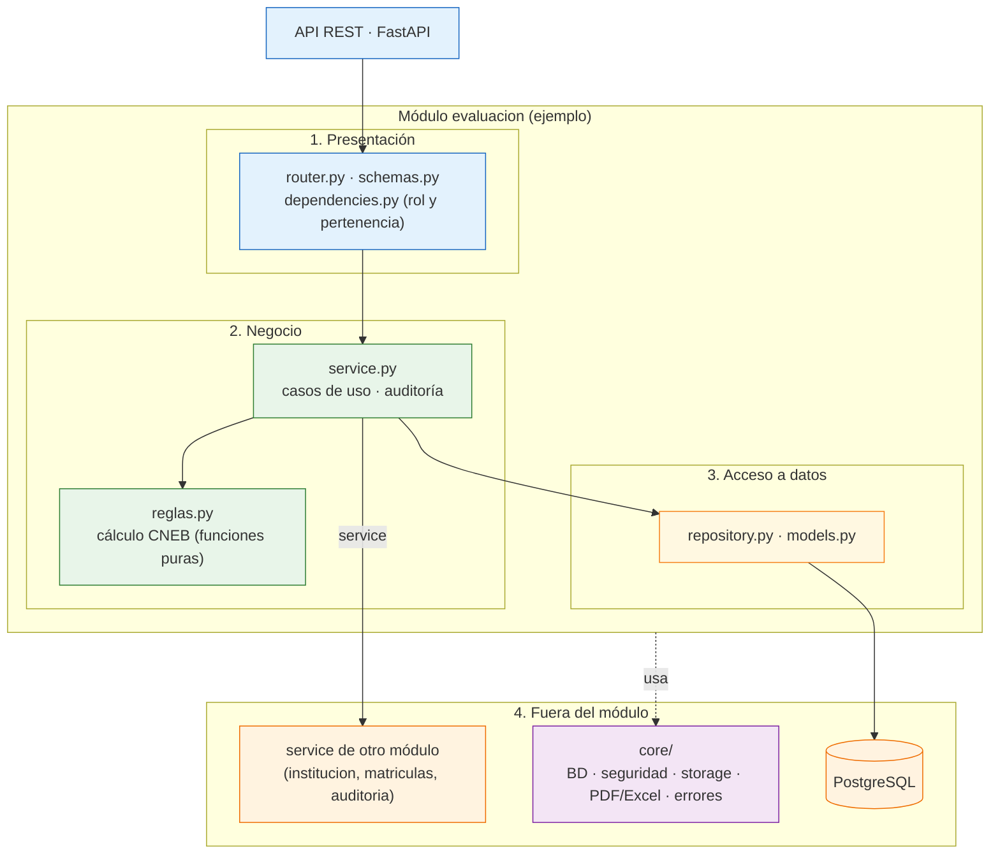

# Enfoque Arquitectónico del Sistema: Arquitectura en Capas Estricta

Este documento describe la organización **interna** del backend: cada módulo (ver [arquitectura-inicial.md](arquitectura-inicial.md)) aplica una arquitectura en capas estricta y todos se despliegan según [estilo-arquitectonico.md](estilo-arquitectonico.md). La decisión está registrada en ADR-008 de [07-Decisiones-arquitectonicas.md](../01-analisis-de-sistema/07-Decisiones-arquitectonicas.md).

## 1. Información General

| Elemento | Descripción aplicada al Portal de Servicios Estudiantiles |
| :--- | :--- |
| **Patrón / Enfoque Arquitectónico** | Arquitectura en capas estricta aplicada por módulo dentro de un monolito modular |
| **Objetivo Principal** | Que cada capa solo llame a la inmediatamente inferior: router → service → repository. |
| **¿Qué problema resuelve?** | Evita mezclar la API REST, las reglas pedagógicas del CNEB (escalas AD, A, B, C, cierre de actas) y el acceso a datos. Se eligió sobre MVC (no define dónde viven las reglas de negocio en una API) y sobre Clean Architecture completa (demasiada ceremonia para un solo desarrollador). |
| **Capas Definidas** | Presentación, Negocio y Acceso a datos (dentro de cada módulo), más Infraestructura transversal en `core/`. |
| **Beneficios** | • Las reglas de evaluación se prueban sin base de datos.<br>• Cambiar el almacenamiento, la cola o el motor de PDF/Excel toca solo `core/`.<br>• Las reglas son simples de seguir para los agentes de IA y se verifican con import-linter en el CI. |

---

## 2. Estructura Modular

```
backend/
  migrations/        → migraciones de la base de datos con Alembic
  tests/             → pruebas con pytest
backend/app/
  core/              → config, database, security, storage, pdf, errors, logging
  modules/
    evaluacion/
      router.py, schemas.py, dependencies.py   → presentación
      service.py, reglas.py, exceptions.py     → negocio
      repository.py, models.py                 → acceso a datos
    (identidad, institucion, personas, matriculas, admision,
     documentos, asistencia, reportes, auditoria: misma estructura)
frontend/src/
  api/generated/     → cliente Orval, no se edita a mano
  features/          → espejo de los módulos del backend
```

---

## 3. Capas y Responsabilidades (dentro de cada módulo)

| Capa | Archivos | Responsabilidad | Nunca debe |
| :--- | :--- | :--- | :--- |
| Presentación | `router.py`, `schemas.py`, `dependencies.py` | Endpoints, validación de formato con Pydantic, autenticación, permisos y pertenencia | Contener reglas de negocio ni llamar al repositorio |
| Negocio | `service.py`, `reglas.py`, `exceptions.py` | Reglas del colegio y del MINEDU, casos de uso, auditoría, errores de dominio | Importar FastAPI, lanzar errores HTTP ni hacer commit |
| Acceso a datos | `repository.py`, `models.py` | Modelos SQLAlchemy, consultas, paginación | Decidir nada ni llamar a un service |
| Infraestructura (transversal) | `core/` | Configuración, sesión de BD, seguridad, storage, PDF/Excel, logging, manejador de errores | — |

**Reglas de disciplina:**
1. La capa de negocio no conoce HTTP: lanza errores propios (`PeriodoCerradoError`) y un manejador global los traduce a Problem Details (RFC 9457).
2. Las reglas complejas (calificación, transiciones de estado) van en funciones puras en `reglas.py`, testeables sin base de datos.
3. Una transacción por petición: el commit ocurre una sola vez al final, nunca dentro de un service.
4. El backend nunca devuelve modelos SQLAlchemy: usa esquemas de entrada y salida separados (`NotaCreate`, `NotaOut`), de los que se genera el cliente TypeScript.

**Patrones complementarios:** Repository, Unit of Work por petición, Strategy para las reglas de calificación por nivel, máquinas de estado para expedientes y periodos, inyección de dependencias con `Depends` y bloqueo optimista (columna `version`) en notas.

**Recorrido de una petición (docente registra una nota):** Pydantic valida el formato → `Depends` verifica token, rol y que el docente enseñe en esa sección → el service consulta el estado del periodo con `reglas.py` → el repositorio guarda → se registra la auditoría → commit → la respuesta sale como `NotaOut`.

---

## 4. Diagrama de Enfoque Arquitectónico (Mermaid)

El diagrama muestra el módulo `evaluacion` como ejemplo; los demás módulos siguen la misma estructura.


