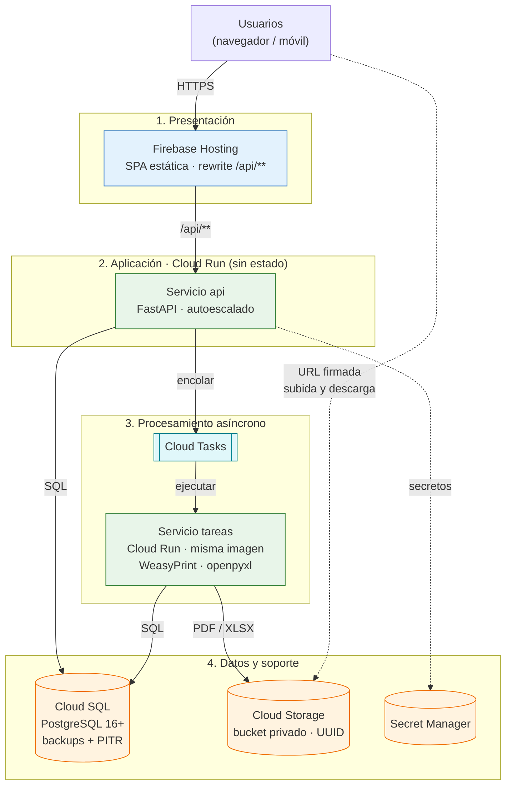

# Estilo Arquitectónico del Sistema: Portal de Servicios Estudiantiles (MVP)

## 1. Descripción General
Se optó por una arquitectura **N-Tier (multicapa) desacoplada** sobre servicios gestionados de Google Cloud, con un tier de aplicación sin estado. Este documento describe la vista de **despliegue** (qué se ejecuta y cómo escala). La estructura **modular** del backend está en [arquitectura-inicial.md](arquitectura-inicial.md) y la organización interna **en capas estricta** de cada módulo en [enfoque-arquitectonico.md](enfoque-arquitectonico.md). Las decisiones se registran en [07-Decisiones-arquitectonicas.md](../01-analisis-de-sistema/07-Decisiones-arquitectonicas.md).

- **Presentación:** SPA en React + TypeScript servida por Firebase Hosting, que además redirige `/api/**` a la API.
- **Aplicación:** API REST en Python 3.12+ con FastAPI, en un contenedor Docker sobre Cloud Run, sin estado de sesión (JWT) y con escalado horizontal automático.
- **Datos:** PostgreSQL 16+ en Cloud SQL (transacciones ACID, backups automáticos y recuperación a un punto en el tiempo) y Cloud Storage privado para documentos.
- **Procesamiento asíncrono:** Cloud Tasks invoca un segundo servicio Cloud Run con la misma imagen (WeasyPrint para PDF y openpyxl para .xlsx).
- **Borde:** Firebase Hosting y Cloud Run terminan TLS (HTTPS obligatorio). Cloud SQL no es accesible desde Internet; el storage se alcanza únicamente con URLs firmadas. Los secretos viven en Secret Manager.
- **Unidad de despliegue:** una sola imagen backend (monolito modular) que se ejecuta como API y como servicio de tareas.

---

## 2. Diagrama de Despliegue (Mermaid)

El navegador sube y descarga documentos directamente de Cloud Storage con URLs firmadas (línea punteada); es el único tráfico que no pasa por la API. Cloud Tasks recibe tareas de la API y vuelve a llamar al servicio de tareas para ejecutarlas.

---

## 3. Tácticas por Atributo de Calidad

| Atributo | Táctica | Componente en el diagrama | Decisión |
|---|---|---|---|
| AC01 Rendimiento | Notas consolidadas precalculadas, endpoint agregado, índices y caché del cliente | Servicio api, Cloud SQL | ADR-006 |
| AC02 Disponibilidad | Instancias reemplazables y backups automáticos con recuperación a un punto en el tiempo; tope de instancias y pool de conexiones para limitar la demanda | Cloud Run, Cloud SQL | ADR-007 |
| AC03 Escalabilidad | Escalado horizontal con balanceo integrado; carga pesada en Cloud Tasks y archivos fuera del servidor | Servicio api, Cloud Tasks, servicio tareas, Cloud Storage | ADR-001, ADR-002, ADR-003 |
| AC04 Seguridad y Privacidad | HTTPS, JWT en cookie httpOnly, RBAC y pertenencia, bucket privado con URLs firmadas de 15 min, cifrado en reposo y Secret Manager | Firebase Hosting, servicio api, Cloud Storage, Secret Manager | ADR-002, ADR-004 |
| AC05 Integridad y Trazabilidad | Transacciones ACID y bitácora append-only escrita desde la capa de negocio | Servicio api, Cloud SQL | ADR-005 |
| AC06 Mantenibilidad | Monolito modular con capas estrictas e infraestructura aislada en `core/` | Servicio api y servicio tareas (misma imagen) | ADR-008 |

---

## 4. MVP, Evolución y Riesgos Aceptados

- **MVP (12 semanas):** todo lo del diagrama, en el escenario B gestionado y optimizado (ADR-007). Cloud Run escala a 0 fuera de los picos y mantiene 1 instancia mínima en cierre de bimestre, publicación de notas y admisión.
- **Evolución:** Redis (Memorystore) si la latencia del pico supera el umbral de AC01, Application Load Balancer con Cloud Armor si se requiere firewall de aplicación, y Cloud SQL en alta disponibilidad según presupuesto.
- **Riesgos aceptados:** el tope de instancias × pool de conexiones debe quedar bajo el límite de conexiones de Cloud SQL; el arranque en frío afecta a la primera petición cuando hay 0 instancias; el token JWT no se revoca antes de expirar.
- **Pendientes:** presupuesto mensual y región de alojamiento de los datos (Ley N.º 29733).
