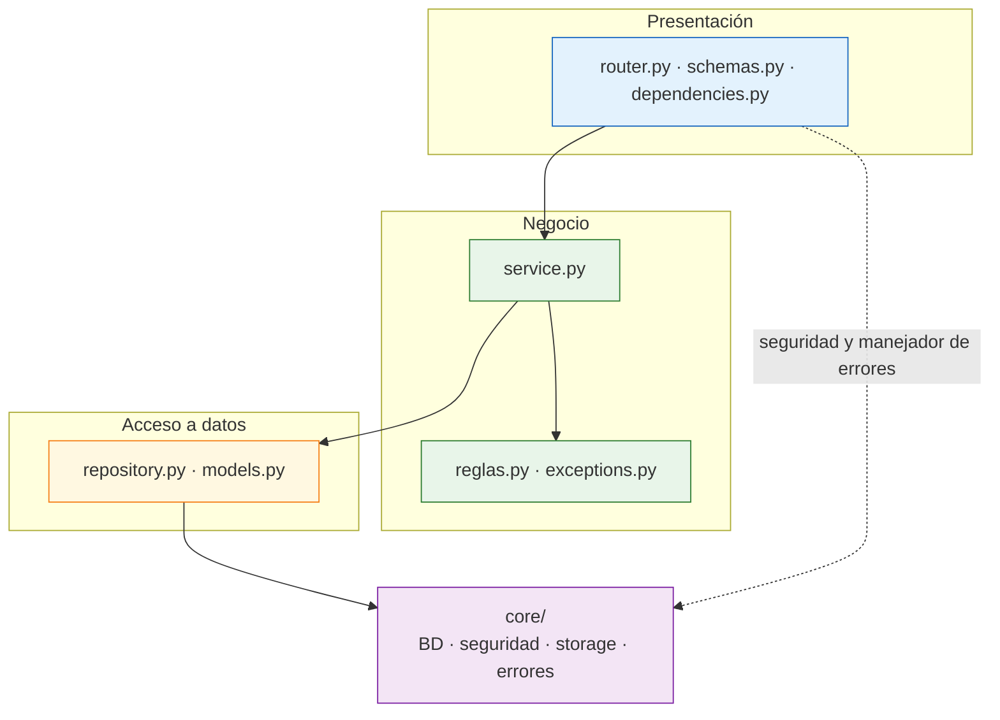
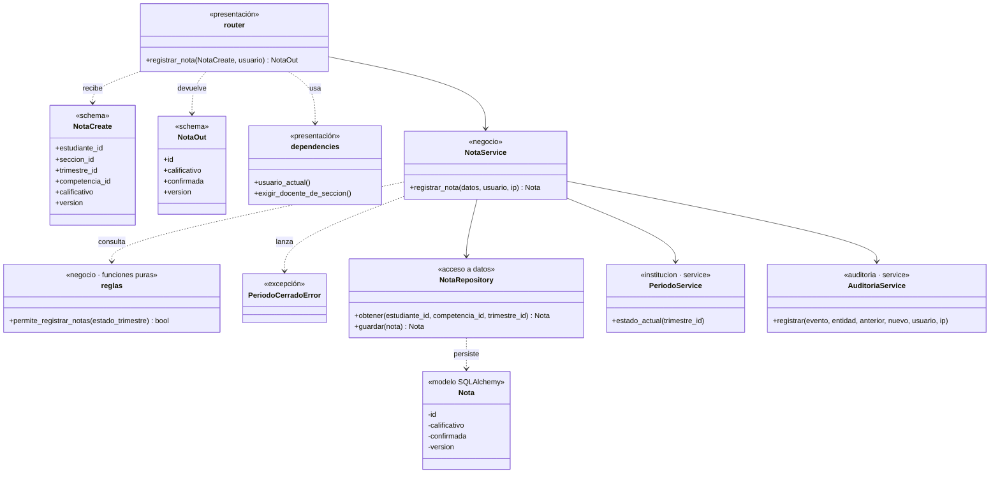
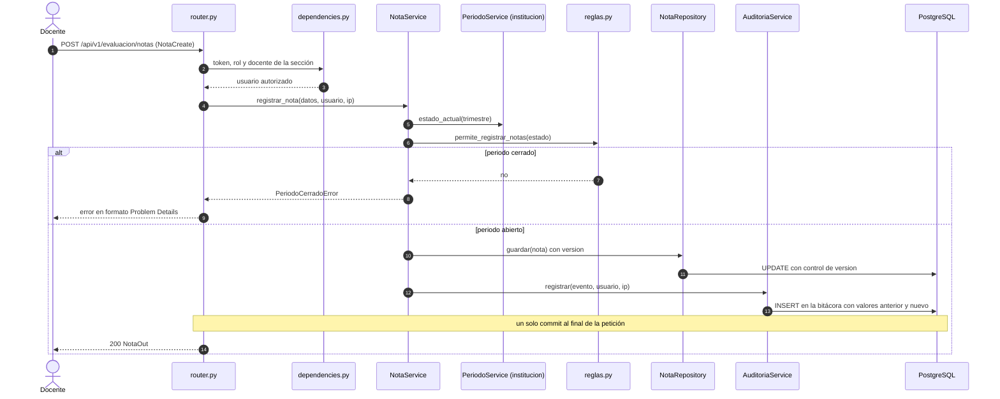

# Diseño interno de módulos

> **Proyecto:** Portal de Servicios Estudiantiles · **Backend:** Python 3.12+ con FastAPI · **Módulo de referencia:** `evaluacion`
> **Enfoque arquitectónico:** arquitectura en capas estricta dentro de cada módulo del monolito modular (ADR-008)
> **Nivel C4:** 4 – Código · **Versión:** 1.0

---

## 1. Propósito

Este documento describe **cómo se organiza el código dentro de un módulo** del backend. Tiene tres objetivos:

- que todos los módulos se construyan con la misma estructura;
- que las reglas del colegio y del MINEDU queden en la capa de negocio, separadas de HTTP y de la base de datos;
- que cualquier persona (o agente de IA) sepa dónde va cada archivo y de qué puede depender.

Se toma `evaluacion` como referencia porque concentra las reglas más delicadas: registro de notas por competencias, estado del trimestre, bloqueo optimista y auditoría (RF06, RF07, RF08, RF18, RF23).

---

## 2. Estructura de carpetas

```text
backend/app/
├── core/                         Infraestructura transversal (config, BD, seguridad, storage, tareas, PDF/Excel, errores, logging)
└── modules/
    └── evaluacion/
        ├── router.py             Endpoints /api/v1/evaluacion/...
        ├── schemas.py            Esquemas Pydantic de entrada y salida (NotaCreate, NotaOut)
        ├── dependencies.py       Dependencias de FastAPI: token, rol y pertenencia docente–sección
        ├── service.py            Casos de uso: registrar y confirmar notas, auditar
        ├── reglas.py             Funciones puras: estado del trimestre, nivel sugerido, conclusiones y promoción
        ├── exceptions.py         Errores de dominio (PeriodoCerradoError, ...)
        ├── repository.py         Consultas SQLAlchemy de notas
        └── models.py             Modelos SQLAlchemy (tabla de notas con columna version)
```

| Archivo | Capa | Responsabilidad | Importa de |
|---|---|---|---|
| `router.py` | Presentación | Declarar endpoints, recibir esquemas validados y devolver `NotaOut` | `schemas`, `dependencies`, `service` |
| `schemas.py` | Presentación | Validar el formato de entrada y definir la salida pública | Pydantic |
| `dependencies.py` | Presentación | Verificar token, rol y que el docente enseñe en la sección | `core/security`, service de otro módulo |
| `service.py` | Negocio | Coordinar el caso de uso y registrar la auditoría | `reglas`, `exceptions`, `repository`, services de otros módulos |
| `reglas.py` | Negocio | Reglas puras, sin BD ni HTTP | Nada del proyecto |
| `exceptions.py` | Negocio | Errores de dominio | Nada |
| `repository.py` | Acceso a datos | Leer y guardar notas | `models`, sesión de `core/database` |
| `models.py` | Acceso a datos | Mapear tablas con SQLAlchemy | SQLAlchemy |

---

## 3. Capas del módulo y regla de dependencia



**Regla de dependencia:** cada capa solo llama a la inmediatamente inferior (router → service → repository). Entre módulos solo se llama al `service` del otro, nunca a su repositorio ni a sus tablas.

| Capa | Contiene | Responsabilidad | Puede depender de | **No** puede |
|---|---|---|---|---|
| **Presentación** | `router.py`, `schemas.py`, `dependencies.py` | Endpoints, formato, autenticación, permisos y pertenencia | Negocio de su módulo, `core/security` | Contener reglas de negocio ni llamar al repositorio |
| **Negocio** | `service.py`, `reglas.py`, `exceptions.py` | Reglas del colegio y del MINEDU, casos de uso, auditoría | Acceso a datos de su módulo, services de otros módulos | Importar FastAPI, lanzar errores HTTP ni hacer commit |
| **Acceso a datos** | `repository.py`, `models.py` | Modelos SQLAlchemy, consultas, paginación | `core/database` | Decidir nada ni llamar a un service |
| **Infraestructura** | `core/` | Configuración, sesión de BD, seguridad, storage, PDF/Excel, logging, manejador de errores | Librerías externas y Google Cloud | — |

> **Cómo comprobarlo:** import-linter en el CI falla si `service.py` importa `fastapi`, si `router.py` importa `repository.py` o si un módulo importa el repositorio de otro (ADR-008).

---

## 4. Diagrama de clases



Los nombres `NotaService`, `NotaRepository`, `PeriodoService` y `AuditoriaService` son la convención propuesta; los documentos de arquitectura fijan los archivos y `NotaCreate`, `NotaOut` y `PeriodoCerradoError`.

### 4.1 Notación UML utilizada

| Símbolo | Significado | Ejemplo |
|---|---|---|
| Línea continua con flecha | Asociación: la clase usa a otra de forma permanente | `NotaService` → `NotaRepository` |
| Línea discontinua con flecha | Dependencia: la usa, la recibe o la lanza | `NotaService` ..> `PeriodoCerradoError` |
| `«estereotipo»` | Capa o tipo del elemento | `«negocio»`, `«schema»` |
| `-` / `+` | Privado / público | `- version`, `+ guardar()` |

---

## 5. Flujo de ejecución: el docente registra una nota



| Paso | Origen → destino | Acción | Capa |
|---|---|---|---|
| 1 | Docente → `router.py` | Envía la nota; Pydantic valida el formato con `NotaCreate` | Presentación |
| 2–3 | `router.py` → `dependencies.py` | Verifica token, rol y que el docente enseñe en esa sección | Presentación |
| 4 | `router.py` → `NotaService` | Ejecuta el caso de uso con el usuario y la IP (`X-Forwarded-For`) | Presentación → Negocio |
| 5–6 | `NotaService` → `PeriodoService` y `reglas.py` | Consulta el estado del trimestre y si permite registrar | Negocio |
| 7–9 | Alternativa | Si no lo permite: `PeriodoCerradoError`, que el manejador global traduce a Problem Details | Negocio → Presentación |
| 10–11 | `NotaService` → `NotaRepository` | Guarda con bloqueo optimista (columna `version`) | Negocio → Acceso a datos |
| 12–13 | `NotaService` → `AuditoriaService` | Registra fecha, usuario, IP, entidad y valores en la bitácora (ADR-005) | Negocio |
| 14 | `router.py` → Docente | Commit único y respuesta `NotaOut` | Presentación |

---

## 6. Código de referencia (ilustrativo)

Muestra la forma de cada capa, no una implementación definitiva. Las reglas exactas de calificación CNEB (RF07) siguen pendientes. Solo se registran notas con el periodo **En Evaluación**, estado que fija el Administrador (RF05).

### 6.1 Negocio · reglas puras

```python
# modules/evaluacion/reglas.py
# Los estados del trimestre pertenecen a institucion; aquí solo se interpreta el recibido.

def permite_registrar_notas(estado_trimestre: str) -> bool:
    """Función pura: se prueba sin base de datos ni HTTP."""
    return estado_trimestre == "En Evaluación"
```

### 6.2 Negocio · service

```python
# modules/evaluacion/service.py  (no importa FastAPI ni hace commit)
from . import reglas
from .exceptions import PeriodoCerradoError

class NotaService:
    def __init__(self, repo, periodos, auditoria):
        self.repo = repo              # NotaRepository
        self.periodos = periodos      # service del módulo institucion
        self.auditoria = auditoria    # service del módulo auditoria

    def registrar_nota(self, datos, usuario, ip):
        estado = self.periodos.estado_actual(datos.trimestre_id)
        if not reglas.permite_registrar_notas(estado):
            raise PeriodoCerradoError(estado)
        anterior = self.repo.obtener(datos.estudiante_id, datos.competencia_id, datos.trimestre_id)
        nota = self.repo.guardar(datos)   # falla si la version cambió
        self.auditoria.registrar("nota_registrada", "nota", anterior, nota, usuario, ip)
        return nota
```

### 6.3 Presentación · router

```python
# modules/evaluacion/router.py
from fastapi import APIRouter, Depends
from .schemas import NotaCreate, NotaOut
from .dependencies import exigir_docente_de_seccion, obtener_service

router = APIRouter(prefix="/evaluacion")

@router.post("/notas", response_model=NotaOut)
def registrar_nota(datos: NotaCreate,
                   usuario=Depends(exigir_docente_de_seccion),
                   service=Depends(obtener_service)):
    return service.registrar_nota(datos, usuario, usuario.ip)
```

> El commit lo hace la dependencia de sesión de `core/database` al terminar la petición (Unit of Work); si algo falla, se revierte todo.

---

## 7. Modelo de seguimiento continuo

El módulo `evaluacion` separa dos capas. El **seguimiento diario** es evidencia formativa visible al publicarse. El **nivel del trimestre** es el dato oficial que alimenta la libreta y el SIAGIE.

| Entidad | Datos principales | Capa | Requisito |
|---|---|---|---|
| Actividad | Sección, asignatura, trimestre, título, fecha, fecha de entrega, competencias, estado (borrador o publicado) | Seguimiento diario | RF23 |
| Resultado | Actividad, estudiante, estado de entrega, calificativo, comentario, `version` | Seguimiento diario | RF23 |
| Observación | Estudiante, docente, fecha, tipo, texto, estado | Seguimiento diario | RF24 |
| Mensaje | Docente, sección o estudiante, tipo (tarea o recordatorio), texto, fecha | Seguimiento diario | RF25 |
| Nivel de trimestre | Estudiante, competencia, trimestre, nivel, conclusión, confirmado, `version` | Nivel oficial | RF07, RF22 |
| Situación final | Estudiante, año lectivo, PRO, PER o RR, origen (calculada o manual), sustento | Nivel oficial | RF28 |

**Reglas del modelo:**

1. El nivel sugerido es el último calificativo publicado de la competencia; nunca es un promedio y el docente siempre lo confirma.
2. Los pendientes no se guardan: se derivan de los resultados sin entregar.
3. Una competencia transversal no pertenece a un área y no cuenta para la situación final.
4. Corregir algo publicado genera auditoría con valores anterior y nuevo.
