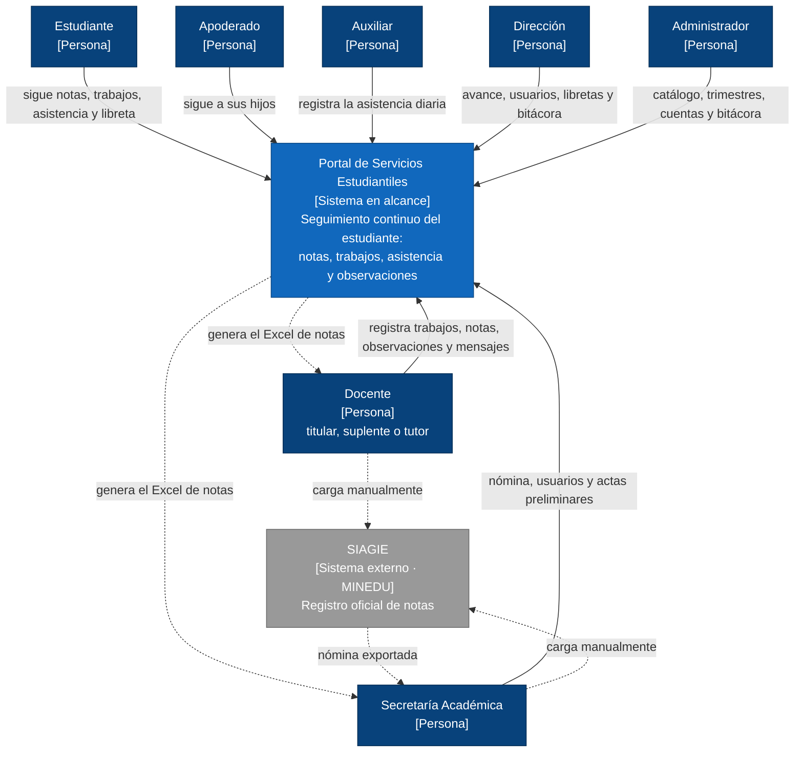

# Nivel 1 · Diagrama de contexto del sistema

> **Proyecto:** Portal de Servicios Estudiantiles (MVP)
> **Modelo:** C4 · Nivel 1 de 4 · **Versión:** 2.0

---

## 1. Objetivo

Mostrar el **portal como una sola caja**: quiénes lo usan y con qué sistemas externos se relaciona. Es la vista de mayor nivel y la primera que se presenta a cualquier persona, técnica o no.

| Aspecto | Descripción |
|---|---|
| Pregunta que responde | ¿Qué es el sistema, quién lo usa y con quién se relaciona? |
| Audiencia | Todos: dirección del colegio, docentes del curso, equipo de desarrollo |
| Qué **no** muestra | Tecnologías, servidores, bases de datos ni módulos internos |
| Siguiente nivel | [02-nivel2-contenedores.md](02-nivel2-contenedores.md) |

---

## 2. Diagrama

---

## 3. Personas (usuarios)

| Persona | Descripción | Qué hace en el sistema |
|---|---|---|
| **Estudiante** | Alumno de primaria o secundaria de la I.E. Emblemática Mariscal Cáceres | Sigue sus notas, trabajos, pendientes, observaciones y asistencia, conoce a sus docentes y descarga su libreta publicada |
| **Apoderado** | Padre, madre o tutor legal | Sigue de forma continua a sus hijos, y solo a ellos, con una sola cuenta |
| **Docente** | Titular, suplente o tutor asignado a cursos y secciones | Registra trabajos, calificativos y observaciones, envía recordatorios, confirma niveles y descarga el Excel de sus cursos |
| **Auxiliar** | Personal asignado a secciones | Registra la asistencia una vez al día |
| **Secretaría Académica** | Personal administrativo académico | Carga la nómina, asigna secciones, agrega y edita usuarios, descarga el Excel por sección y emite actas preliminares |
| **Dirección** | Directivos de la institución | Consulta el avance, agrega y edita usuarios, publica libretas, reabre notas y consulta la bitácora |
| **Administrador** | Responsable técnico del sistema | Configura el catálogo, cambia los estados de los trimestres, gestiona cuentas y credenciales, y consulta la bitácora |

---

## 4. Sistemas

| Sistema | Tipo | Responsabilidad | Quién lo construye |
|---|---|---|---|
| **Portal de Servicios Estudiantiles** | Sistema en alcance | Centraliza el seguimiento continuo del estudiante y reduce la carga de registro docente | El equipo del proyecto |
| **SIAGIE** | Sistema externo (MINEDU) | Registro oficial de notas y matrículas del Ministerio de Educación | MINEDU |

---

## 5. Relaciones

| Origen | Destino | Descripción | Mecanismo |
|---|---|---|---|
| Estudiante | Portal | Sigue su avance | — |
| Apoderado | Portal | Sigue a sus hijos | — |
| Docente | Portal | Registra trabajos, notas, observaciones y mensajes | — |
| Auxiliar | Portal | Registra la asistencia diaria | — |
| Secretaría Académica | Portal | Gestiona nómina, usuarios y actas preliminares | — |
| Dirección | Portal | Consulta el avance, gestiona usuarios y libretas | — |
| Administrador | Portal | Gestiona catálogo, trimestres, cuentas y bitácora | — |
| Portal | Docente y Secretaría Académica | Entrega el Excel de notas (.xlsx) | Descarga de archivo |
| Docente y Secretaría Académica | SIAGIE | Cargan el Excel | Manual (sin integración) |
| SIAGIE | Secretaría Académica | Entrega la nómina que se carga en el portal | Exportación manual |

> En el nivel 1 no se indican protocolos entre personas y sistema: eso se detalla en el nivel 2.

---

## 6. Decisiones y supuestos

| # | Decisión o supuesto | Motivo |
|---|---|---|
| 1 | No hay integración automática con SIAGIE en el MVP; solo intercambio por Excel | Decisión de alcance del MVP (RC06) |
| 2 | El usuario de acceso es el documento de identidad, la cuenta se activa con un código y el Administrador restablece contraseñas | Muchos apoderados no usan correo (ADR-004, RF14) |
| 3 | Los datos de menores solo son accesibles para usuarios autorizados por rol y pertenencia | Ley N.º 29733 y AC04 |
| 4 | Fuera de alcance: matrícula, admisión, traslados, pagos, subida de trabajos, biometría, LMS y chat | Plazo del MVP de 12 semanas (RC08) |

### Pendientes por definir

| Tema | Detalle |
|---|---|
| Región de alojamiento de los datos | Se propone Santiago; debe confirmarse por la Ley N.º 29733 (ver estilo arquitectónico) |
| Plantilla SIAGIE y nómina | Se necesitan ejemplares reales con datos ficticios para fijar el formato (RC06) |
| Notificaciones | El MVP muestra novedades dentro del portal; si se agregan avisos por SMS o mensajería, el proveedor aparecerá aquí como sistema externo |
