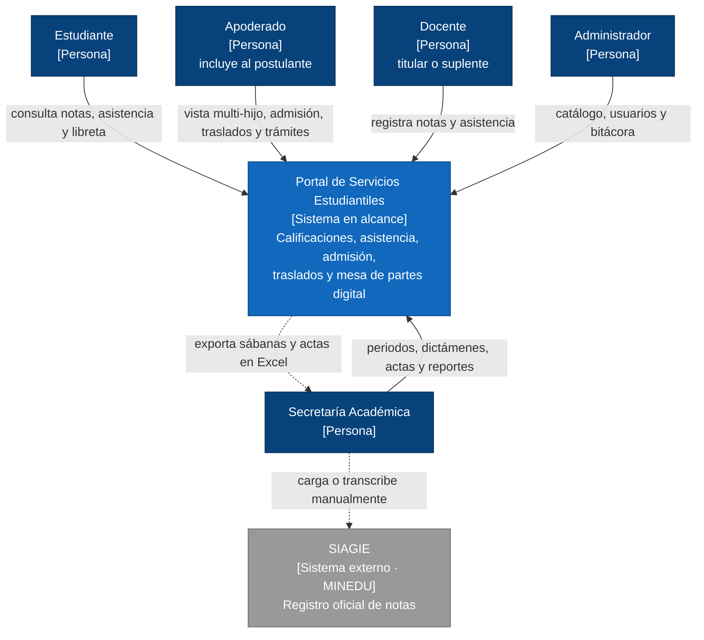

# Nivel 1 · Diagrama de contexto del sistema

> **Proyecto:** Portal de Servicios Estudiantiles (MVP)
> **Modelo:** C4 · Nivel 1 de 4 · **Versión:** 1.0

---

## 1. Objetivo

Mostrar el **portal como una sola caja**: quiénes lo usan y con qué sistemas externos se relaciona. Es la vista de mayor nivel y la primera que se presenta a cualquier persona, técnica o no.

| Aspecto | Descripción |
|---|---|
| Pregunta que responde | ¿Qué es el sistema, quién lo usa y con quién se relaciona? |
| Audiencia | Todos: dirección del colegio, docentes del curso, equipo de desarrollo |
| Qué **no** muestra | Tecnologías, servidores, bases de datos ni módulos internos |
| Siguiente nivel | [02-nivel2-contenedores.md](02-nivel2-contenedores.md) |

---

## 2. Diagrama

---

## 3. Personas (usuarios)

| Persona | Descripción | Qué hace en el sistema |
|---|---|---|
| **Estudiante** | Alumno de la I.E. Emblemática Mariscal Cáceres | Consulta sus calificaciones confirmadas, su asistencia y la plana docente, y descarga su libreta en PDF |
| **Apoderado** | Padre, madre o tutor; incluye al postulante sin cuenta | Supervisa a varios hijos con una sola cuenta, solicita admisión o traslado, sube documentos y sigue sus trámites con un ticket |
| **Docente** | Titular o suplente asignado a cursos y secciones | Registra calificaciones por competencias y la asistencia diaria, y confirma el cierre de sus cursos |
| **Secretaría Académica** | Personal administrativo académico | Cambia los estados del periodo, dictamina expedientes, genera pre-matrículas, emite actas y reportes y restablece contraseñas |
| **Administrador** | Responsable técnico del sistema | Configura el catálogo escolar, administra usuarios y roles y consulta la bitácora de auditoría |

---

## 4. Sistemas

| Sistema | Tipo | Responsabilidad | Quién lo construye |
|---|---|---|---|
| **Portal de Servicios Estudiantiles** | Sistema en alcance | Centraliza la vida académica (notas, asistencia) y la ventanilla virtual (admisión, traslados, documentos) | El equipo del proyecto |
| **SIAGIE** | Sistema externo (MINEDU) | Registro oficial de notas y matrículas del Ministerio de Educación | MINEDU |

---

## 5. Relaciones

| Origen | Destino | Descripción | Mecanismo |
|---|---|---|---|
| Estudiante | Portal | Consulta notas, asistencia y libreta | — |
| Apoderado | Portal | Vista multi-hijo, admisión, traslados y seguimiento de trámites | — |
| Docente | Portal | Registra notas y asistencia | — |
| Secretaría Académica | Portal | Gestiona periodos, dictámenes, actas y reportes | — |
| Administrador | Portal | Gestiona catálogo, usuarios y bitácora | — |
| Portal | Secretaría Académica | Entrega sábanas y actas en Excel (.xlsx) | Descarga de archivo |
| Secretaría Académica | SIAGIE | Carga o transcribe los datos | Manual (sin integración) |

> En el nivel 1 no se indican protocolos entre personas y sistema: eso se detalla en el nivel 2.

---

## 6. Decisiones y supuestos

| # | Decisión o supuesto | Motivo |
|---|---|---|
| 1 | No hay integración automática con SIAGIE en el MVP; solo exportación Excel | Decisión de alcance del MVP (RC06) |
| 2 | El usuario de acceso es el DNI y Secretaría restablece contraseñas | Muchos apoderados no usan correo (ADR-004, RF14) |
| 3 | Los datos de menores solo son accesibles para usuarios autorizados por rol y pertenencia | Ley N.º 29733 y AC04 |
| 4 | Fuera de alcance: pagos, biometría, LMS y chat | Plazo del MVP de 12 semanas (RC08) |

### Pendientes por definir

| Tema | Detalle |
|---|---|
| Región de alojamiento de los datos | Debe confirmarse por la Ley N.º 29733 (ver estilo arquitectónico) |
| Notificaciones | No hay requisito de avisos por correo o SMS en el MVP; si se agrega, el proveedor aparecerá aquí como sistema externo |
