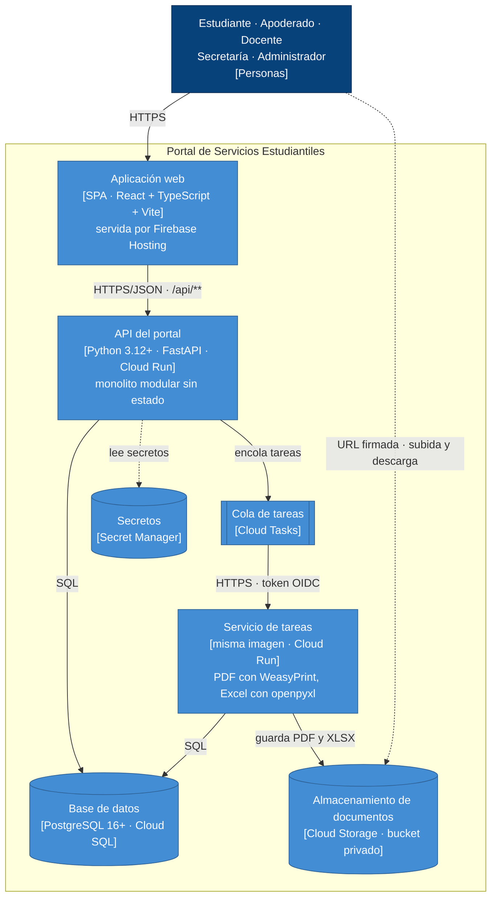

# Nivel 2 · Diagrama de contenedores

> **Proyecto:** Portal de Servicios Estudiantiles (MVP)
> **Modelo:** C4 · Nivel 2 de 4 · **Versión:** 1.0

---

## 1. Objetivo

Abrir la caja «Portal de Servicios Estudiantiles» del nivel 1 y mostrar los **contenedores** que la forman: las aplicaciones y almacenes de datos que se ejecutan por separado, la tecnología de cada uno y cómo se comunican.

| Aspecto | Descripción |
|---|---|
| Pregunta que responde | ¿De qué piezas ejecutables se compone el sistema y con qué tecnología? |
| Audiencia | Arquitectura, desarrollo y operación |
| Qué es un contenedor | Algo que se ejecuta o almacena datos de forma independiente: una aplicación web, una API, una base de datos (no es lo mismo que un contenedor Docker) |
| Nivel anterior | [01-nivel1-contexto.md](01-nivel1-contexto.md) |
| Siguiente nivel | [03-nivel3-componentes.md](03-nivel3-componentes.md) |

---

## 2. Diagrama

---

## 3. Contenedores

| Contenedor | Tecnología | Responsabilidad | Datos que maneja |
|---|---|---|---|
| **Aplicación web** | SPA en React + TypeScript + Vite, servida por Firebase Hosting | Interfaz de todos los roles, incluida la vista familiar multi-hijo y la ventanilla pública. Redirige `/api/**` a la API | Ninguno persistente; caché del cliente con TanStack Query |
| **API del portal** | Python 3.12+, FastAPI, sobre Cloud Run | Expone la API REST, aplica reglas de negocio, autenticación y RBAC. Es un **monolito modular** sin estado de sesión | Ninguno propio; usa la base de datos |
| **Servicio de tareas** | Misma imagen que la API, en otro servicio de Cloud Run | Genera libretas PDF, actas Excel y verifica documentos subidos, sin bloquear las peticiones | Ninguno propio |
| **Cola de tareas** | Cloud Tasks | Encola trabajos pesados y los entrega al servicio de tareas con reintentos | Trabajos pendientes |
| **Base de datos** | PostgreSQL 16+ en Cloud SQL | Información permanente del colegio, con backups y recuperación a un punto en el tiempo | Usuarios, catálogo, personas, matrículas, expedientes, notas, asistencia y bitácora |
| **Almacenamiento de documentos** | Cloud Storage, bucket privado | Custodia probatorios y libretas con nombres UUID y cifrado en reposo | DNI, partidas, certificados, libretas y actas |
| **Secretos** | Secret Manager | Guarda credenciales y claves de la API | Secretos |

---

## 4. Relaciones

| Origen | Destino | Descripción | Protocolo |
|---|---|---|---|
| Personas | Aplicación web | Usan el portal desde navegador o móvil | HTTPS |
| Aplicación web | API del portal | Llama a la API mediante el rewrite `/api/**` | HTTPS/JSON |
| API del portal | Base de datos | Lee y escribe información | SQL |
| API del portal | Cola de tareas | Encola libretas, actas y verificaciones después del commit | HTTPS (API de Cloud Tasks) |
| Cola de tareas | Servicio de tareas | Ejecuta cada tarea | HTTPS con token OIDC |
| Servicio de tareas | Base de datos | Lee notas consolidadas | SQL |
| Servicio de tareas | Almacenamiento de documentos | Guarda PDF y XLSX | HTTPS (API de Cloud Storage) |
| Personas | Almacenamiento de documentos | Suben y descargan archivos sin pasar por la API | HTTPS con URL firmada de 15 min |
| API del portal | Secretos | Lee credenciales | HTTPS (API de Secret Manager) |

---

## 5. Decisiones arquitectónicas reflejadas

| Decisión | Alternativa descartada | Motivo |
|---|---|---|
| Un único backend (monolito modular) en Cloud Run (ADR-001, ADR-008) | Microservicios | Inviable para un desarrollador en 12 semanas; los módulos permiten separar en el futuro |
| Frontend separado (SPA + API REST) | Next.js con renderizado en servidor | El SSR no aporta detrás de un login |
| Subida y descarga directas a Cloud Storage con URLs firmadas (ADR-002) | Pasar los archivos por la API | Evita saturar la API en campañas de admisión |
| Cloud Tasks y un segundo servicio para trabajos pesados (ADR-003) | Redis o RabbitMQ con un worker siempre encendido | Pago por uso y compatible con escalar a cero |
| Lectura en pico sin caché en servidor (ADR-006) | Redis desde el inicio | Sin costo fijo; Redis se activa si la latencia supera AC01 |
| Servicios gestionados de Google Cloud (ADR-007) | Una VM con Docker Compose | Backups y escalado gestionados con gasto fijo medio-bajo |

---

## 6. Seguridad entre contenedores

| Comunicación | Medida |
|---|---|
| Navegador → aplicación web y API | HTTPS obligatorio |
| Aplicación web → API | JWT de vida corta en la cookie httpOnly `__session`, protección CSRF, RBAC y pertenencia (ADR-004) |
| Cola de tareas → servicio de tareas | El servicio solo acepta peticiones con token OIDC |
| API → base de datos | Cloud SQL no es accesible desde Internet; el rol de la aplicación no puede modificar la bitácora (ADR-005) |
| Navegador → almacenamiento | Bucket privado; solo URLs firmadas de 15 minutos (RC05) |
| API → secretos | Credenciales solo en Secret Manager |
