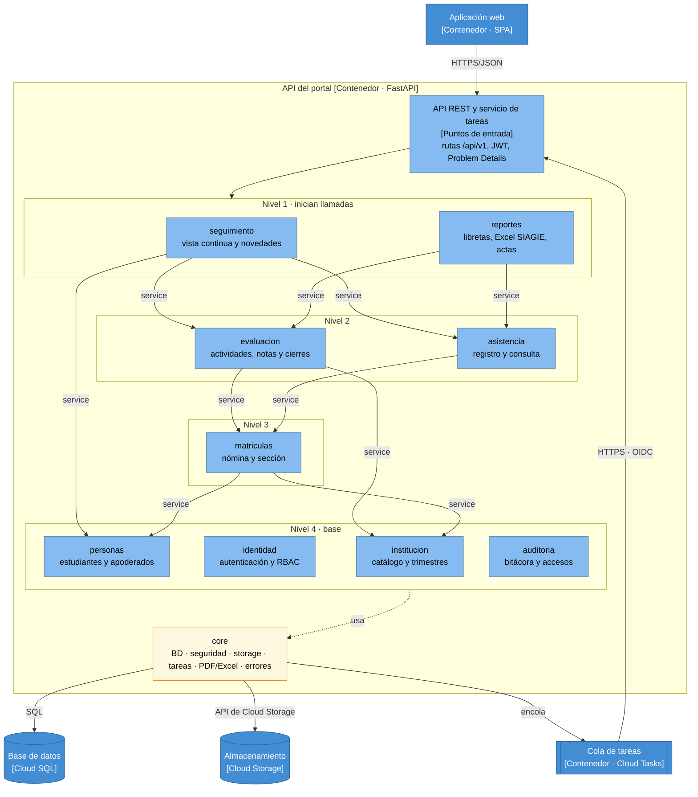

# Nivel 3 · Diagrama de componentes

> **Proyecto:** Portal de Servicios Estudiantiles · **Contenedor detallado:** API del portal
> **Modelo:** C4 · Nivel 3 de 4 · **Versión:** 2.0

---

## 1. Objetivo

Abrir el contenedor **API del portal** del nivel 2 y mostrar sus **componentes**: los módulos del monolito modular, la responsabilidad de cada uno y cómo se relacionan entre sí y con la base de datos, el almacenamiento y la cola de tareas.

| Aspecto | Descripción |
|---|---|
| Pregunta que responde | ¿Cómo se divide el backend por dentro y qué hace cada parte? |
| Audiencia | Arquitectura y desarrollo |
| Qué es un componente | Un grupo de funcionalidades con una responsabilidad clara. En este proyecto, cada **módulo** del monolito es un componente |
| Nivel anterior | [02-nivel2-contenedores.md](02-nivel2-contenedores.md) |
| Siguiente nivel | [04-nivel4-codigo.md](04-nivel4-codigo.md) |

---

## 2. Diagrama

Los niveles ordenan las llamadas `service` a `service` documentadas en la vista modular: cada módulo solo llama a los de niveles inferiores. Todos los módulos usan `core`; la flecha sale de la base para no repetirla. `admision` y `documentos` no se dibujan porque son de una versión futura.

---

## 3. Componentes

| Componente | Responsabilidad | Requisitos | Carpeta en el código |
|---|---|---|---|
| **Puntos de entrada** | API REST y servicio de tareas: rutas, JWT, validación y manejador de errores | — | `backend/app/main.py`, `core/` |
| **seguimiento** | Vista continua de apoderados, estudiantes y sección; sin tablas propias salvo la última visita | RF01, RF26, RF31 | `backend/app/modules/seguimiento/` |
| **reportes** | Libretas, Excel SIAGIE, actas preliminares y publicación de libretas | RF15, RF16, RF27 | `backend/app/modules/reportes/` |
| **evaluacion** | Actividades, resultados, observaciones, mensajes, niveles, conclusiones, cierres y reapertura | RF06, RF07, RF08, RF22, RF23, RF24, RF25, RF28, RF30 | `backend/app/modules/evaluacion/` |
| **asistencia** | Registro y consulta de asistencia diaria | RF19, RF20 | `backend/app/modules/asistencia/` |
| **matriculas** | Nómina vigente, asignación a sección y estado del estudiante | RF21 | `backend/app/modules/matriculas/` |
| **institucion** | Catálogo escolar (incluidas asignaturas y competencias), años, trimestres y asignaciones | RF03, RF04, RF05 | `backend/app/modules/institucion/` |
| **personas** | Estudiantes, apoderados, personal y vínculo apoderado–estudiante | Datos de RF01 y RF21 | `backend/app/modules/personas/` |
| **identidad** | Autenticación, RBAC, usuarios, activación y credenciales | RF14 | `backend/app/modules/identidad/` |
| **auditoria** | Bitácora y registro de accesos (los services registran; el módulo consulta) | RF18, RF29 | `backend/app/modules/auditoria/` |
| **core** | Infraestructura transversal: configuración, sesión de BD, seguridad, storage, tareas, PDF/Excel, logging | — | `backend/app/core/` |
| **admision**, **documentos** | Versión futura: preinscripción, traslados, dictamen y probatorios | RF09 a RF13 | Sin construir |

---

## 4. Relaciones entre componentes

| Origen | Destino | Descripción | Tipo de comunicación |
|---|---|---|---|
| Aplicación web | Puntos de entrada | Llama a la API | HTTPS/JSON |
| Cola de tareas | Puntos de entrada | Ejecuta tareas en el servicio de tareas | HTTPS con token OIDC |
| `seguimiento` | `evaluacion`, `asistencia`, `personas` | Compone la vista y verifica la pertenencia | Llamada en memoria al `service` |
| `reportes` | `evaluacion`, `asistencia` | Lee niveles, conclusiones y asistencia para libretas, Excel y actas | Llamada en memoria al `service` |
| `evaluacion` | `institucion`, `matriculas`, `auditoria` | Consulta el trimestre y la sección, pide el cambio a Cerrado y registra la auditoría | Llamada en memoria al `service` (según el enfoque arquitectónico) |
| `asistencia` | `matriculas` | Consulta los estudiantes de cada sección | Llamada en memoria al `service` |
| `matriculas` | `personas`, `institucion` | Registra al estudiante de la nómina y valida su sección | Llamada en memoria al `service` |
| `evaluacion` | `reportes` | Tras cerrar el trimestre, solicita las libretas por sección sin importar `reportes` (ADR-009) | Tarea en Cloud Tasks vía `core` |

> La matriz completa de dependencias se define junto con el modelo de datos (ver vista modular).

---

## 5. Relaciones con contenedores

| Componente | Destino | Descripción | Protocolo | Patrón aplicado |
|---|---|---|---|---|
| Todos los módulos | Base de datos | Cada módulo lee y escribe **solo sus propias tablas** | SQL | Repository y Unit of Work |
| `reportes` (vía `core`) | Almacenamiento | Firma URLs y guarda archivos | API de Cloud Storage | Adapter |
| `evaluacion`, `reportes` (vía `core`) | Cola de tareas | Encola libretas y actas después del commit | API de Cloud Tasks | Adapter |

---

## 6. Reglas del monolito modular

| # | Regla | Motivo |
|---|---|---|
| 1 | Todos los componentes se despliegan juntos en la API del portal y en el servicio de tareas (misma imagen) | Un solo despliegue para un desarrollador (ADR-008) |
| 2 | Un módulo solo llama al `service` de otro, nunca a su repositorio ni a sus tablas | Un cambio interno no rompe a los demás |
| 3 | Las llamadas entre módulos comparten la transacción de la petición | Si falla un paso del cierre, no queda ningún cambio parcial |
| 4 | Las dependencias no forman ciclos | Mantiene los niveles y facilita las pruebas |
| 5 | Solo `core/` habla con Google Cloud y las librerías de PDF/Excel | La infraestructura se cambia en un solo lugar |
| 6 | Cada módulo se organiza por dentro en capas estrictas | Ver nivel 4 y [01-diseno-interno-de-modulos.md](../03-diseno-de-software/01-diseno-interno-de-modulos.md) |
