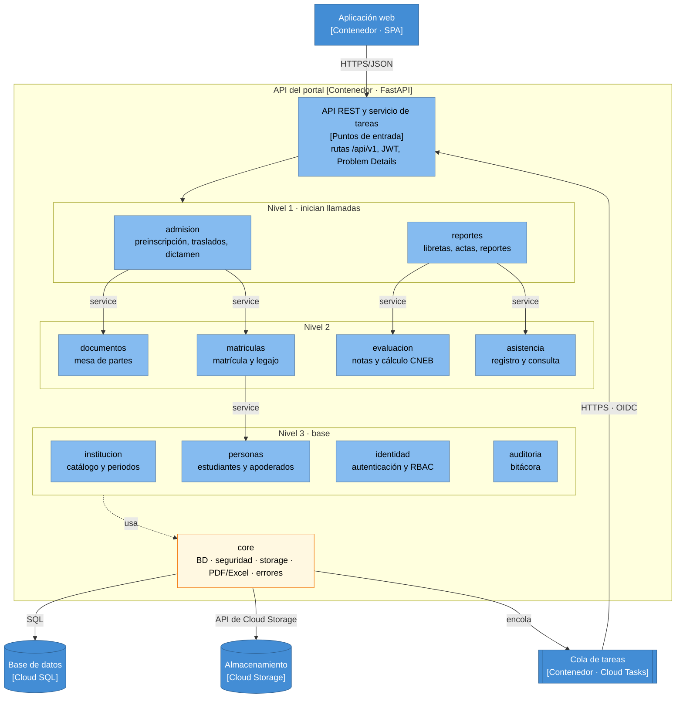

# Nivel 3 · Diagrama de componentes

> **Proyecto:** Portal de Servicios Estudiantiles · **Contenedor detallado:** API del portal
> **Modelo:** C4 · Nivel 3 de 4 · **Versión:** 1.0

---

## 1. Objetivo

Abrir el contenedor **API del portal** del nivel 2 y mostrar sus **componentes**: los módulos del monolito modular, la responsabilidad de cada uno y cómo se relacionan entre sí y con la base de datos, el almacenamiento y la cola de tareas.

| Aspecto | Descripción |
|---|---|
| Pregunta que responde | ¿Cómo se divide el backend por dentro y qué hace cada parte? |
| Audiencia | Arquitectura y desarrollo |
| Qué es un componente | Un grupo de funcionalidades con una responsabilidad clara. En este proyecto, cada **módulo** del monolito es un componente |
| Nivel anterior | [02-nivel2-contenedores.md](02-nivel2-contenedores.md) |
| Siguiente nivel | [04-nivel4-codigo.md](04-nivel4-codigo.md) |

---

## 2. Diagrama

Los niveles ordenan las llamadas `service` a `service` documentadas en la vista modular: cada módulo solo llama a los de niveles inferiores. Todos los módulos usan `core`; la flecha sale de la base para no repetirla diez veces.

---

## 3. Componentes

| Componente | Responsabilidad | Requisitos | Carpeta en el código |
|---|---|---|---|
| **Puntos de entrada** | API REST y servicio de tareas: rutas, JWT, validación y manejador de errores | — | `backend/app/main.py`, `core/` |
| **identidad** | Autenticación, RBAC, usuarios y credenciales | RF14 | `backend/app/modules/identidad/` |
| **institucion** | Catálogo escolar, periodos lectivos y asignación docente | RF03, RF04, RF05 | `backend/app/modules/institucion/` |
| **personas** | Estudiantes, apoderados, docentes y vínculo apoderado–estudiante | RF01 | `backend/app/modules/personas/` |
| **matriculas** | Matrícula, pre-matrícula y legajo | RF02 | `backend/app/modules/matriculas/` |
| **admision** | Preinscripción, traslados, ticket y dictamen | RF09, RF10, RF11, RF13 | `backend/app/modules/admision/` |
| **documentos** | Subida y descarga de probatorios | RF12 | `backend/app/modules/documentos/` |
| **evaluacion** | Cuadrícula de notas, cálculo CNEB y confirmación | RF06, RF07, RF08 | `backend/app/modules/evaluacion/` |
| **asistencia** | Registro y consulta de asistencia diaria | RF19, RF20 | `backend/app/modules/asistencia/` |
| **reportes** | Libretas, actas, cuadros de mérito y reportes de control | RF15, RF16, RF17 | `backend/app/modules/reportes/` |
| **auditoria** | Bitácora (los services registran; el módulo consulta) | RF18 | `backend/app/modules/auditoria/` |
| **core** | Infraestructura transversal: configuración, sesión de BD, seguridad, storage, PDF/Excel, logging | — | `backend/app/core/` |

---

## 4. Relaciones entre componentes

| Origen | Destino | Descripción | Tipo de comunicación |
|---|---|---|---|
| Aplicación web | Puntos de entrada | Llama a la API | HTTPS/JSON |
| Cola de tareas | Puntos de entrada | Ejecuta tareas en el servicio de tareas | HTTPS con token OIDC |
| `admision` | `matriculas` | Al aprobar un expediente crea la matrícula en la misma transacción | Llamada en memoria al `service` |
| `admision` | `documentos` | Vincula los probatorios del expediente | Llamada en memoria al `service` |
| `matriculas` | `personas` | Registra o recupera al estudiante y su apoderado | Llamada en memoria al `service` |
| `reportes` | `evaluacion`, `asistencia` | Lee notas y asistencia para libretas y actas | Llamada en memoria al `service` |
| `evaluacion` | `institucion`, `matriculas`, `auditoria` | Consulta el periodo y la matrícula y registra la auditoría | Llamada en memoria al `service` (según el enfoque arquitectónico) |

> La matriz completa de dependencias se define junto con el modelo de datos (ver vista modular).

---

## 5. Relaciones con contenedores

| Componente | Destino | Descripción | Protocolo | Patrón aplicado |
|---|---|---|---|---|
| Todos los módulos | Base de datos | Cada módulo lee y escribe **solo sus propias tablas** | SQL | Repository y Unit of Work |
| `documentos`, `reportes` (vía `core`) | Almacenamiento | Firma URLs y guarda archivos | API de Cloud Storage | Adapter |
| `reportes`, `documentos` (vía `core`) | Cola de tareas | Encola libretas, actas y verificaciones después del commit | API de Cloud Tasks | Adapter |

---

## 6. Reglas del monolito modular

| # | Regla | Motivo |
|---|---|---|
| 1 | Todos los componentes se despliegan juntos en la API del portal y en el servicio de tareas (misma imagen) | Un solo despliegue para un desarrollador (ADR-008) |
| 2 | Un módulo solo llama al `service` de otro, nunca a su repositorio ni a sus tablas | Un cambio interno no rompe a los demás |
| 3 | Las llamadas entre módulos comparten la transacción de la petición | Si la matrícula falla, la aprobación del expediente se revierte |
| 4 | Las dependencias no forman ciclos | Mantiene los niveles y facilita las pruebas |
| 5 | Solo `core/` habla con Google Cloud y las librerías de PDF/Excel | La infraestructura se cambia en un solo lugar |
| 6 | Cada módulo se organiza por dentro en capas estrictas | Ver nivel 4 y [01-diseno-interno-de-modulos.md](../03-diseno-de-software/01-diseno-interno-de-modulos.md) |
