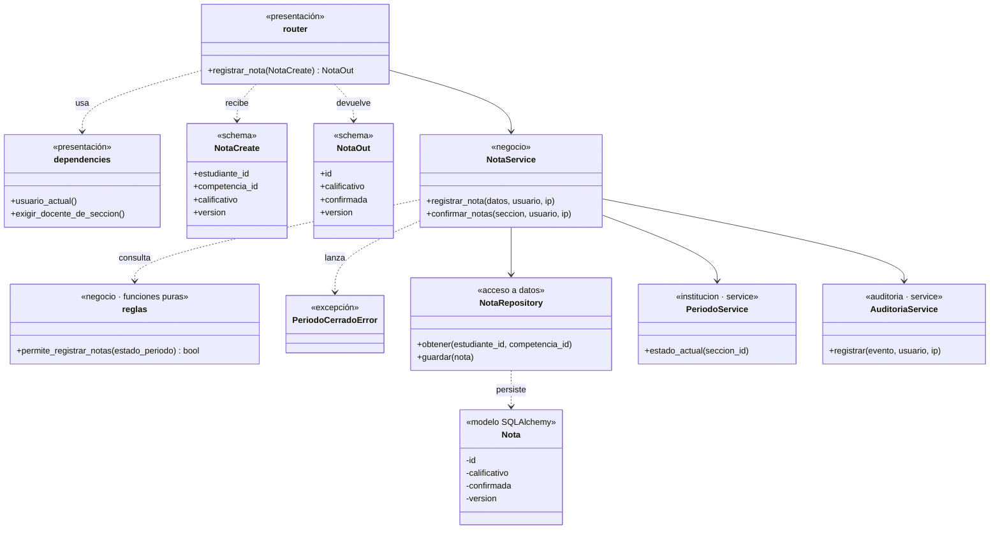
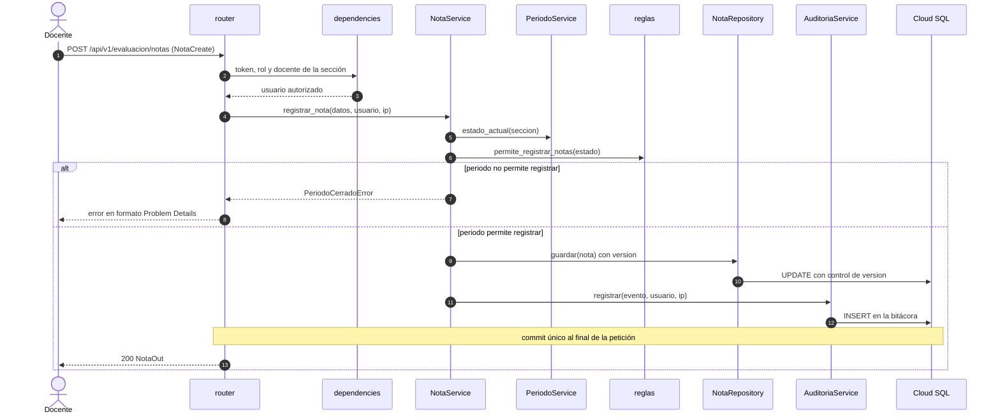

# Nivel 4 · Diagrama de código

> **Proyecto:** Portal de Servicios Estudiantiles · **Módulo detallado:** `evaluacion` (con `institucion` y `auditoria`)
> **Modelo:** C4 · Nivel 4 de 4 · **Notación:** UML · **Versión:** 1.0

---

## 1. Objetivo

Mostrar **cómo está organizado el código** de un componente del nivel 3: sus clases y funciones y la forma en que colaboran. Se detalla el flujo **Registrar una nota**, que involucra a `evaluacion` y a los services de `institucion` y `auditoria`.

| Aspecto | Descripción |
|---|---|
| Pregunta que responde | ¿Qué clases existen dentro de un módulo y cómo se relacionan? |
| Audiencia | Desarrollo |
| Notación | UML (diagrama de clases y diagrama de secuencia), como recomienda C4 para este nivel |
| Por qué solo `evaluacion` | El nivel 4 es opcional en C4 y se dibuja para el componente más importante. `evaluacion` concentra las reglas del MINEDU, la concurrencia y la auditoría |
| Nivel anterior | [03-nivel3-componentes.md](03-nivel3-componentes.md) |

---

## 2. Diagrama de clases

### 2.1 Capas

| Capa | Contiene | Regla |
|---|---|---|
| **Presentación** | `router.py`, `schemas.py`, `dependencies.py` | Traduce HTTP a llamadas del service y verifica rol y pertenencia |
| **Negocio** | `service.py`, `reglas.py`, `exceptions.py` | Aplica las reglas del colegio y del MINEDU; no importa FastAPI ni hace commit |
| **Acceso a datos** | `repository.py`, `models.py` | Lee y escribe con SQLAlchemy; no decide nada |

> **Regla de dependencia:** router → service → repository. Hacia otros módulos solo se llama a su `service` (`PeriodoService`, `AuditoriaService`).

### 2.2 Clases del módulo `evaluacion`

| Clase | Tipo | Capa | Responsabilidad |
|---|---|---|---|
| `router` | Endpoints de FastAPI | Presentación | Recibe `POST /api/v1/evaluacion/notas` y responde |
| `dependencies` | Dependencias de FastAPI | Presentación | Token, rol y que el docente enseñe en esa sección |
| `NotaCreate` / `NotaOut` | Esquemas Pydantic | Presentación | Entrada validada y salida pública |
| `NotaService` | Service | Negocio | Coordina el registro y la confirmación de notas y la auditoría |
| `reglas` | Funciones puras | Negocio | Decide si el estado del periodo permite registrar |
| `PeriodoCerradoError` | Excepción de dominio | Negocio | Se traduce a Problem Details en el manejador global |
| `NotaRepository` | Repositorio | Acceso a datos | Guarda con control de `version` |
| `Nota` | Modelo SQLAlchemy | Acceso a datos | Tabla de notas con bloqueo optimista |

### 2.3 Services de otros módulos

| Clase | Módulo | Responsabilidad en este flujo |
|---|---|---|
| `PeriodoService` | `institucion` | Devuelve el estado actual del periodo lectivo |
| `AuditoriaService` | `auditoria` | Registra fecha, usuario e IP en la bitácora (append-only) |

`NotaService`, `NotaRepository`, `PeriodoService` y `AuditoriaService` son la convención de nombres propuesta; los documentos de arquitectura fijan los archivos y `NotaCreate`, `NotaOut` y `PeriodoCerradoError`.

### 2.4 Notación UML utilizada

| Símbolo | Significado | Ejemplo |
|---|---|---|
| Línea continua con flecha | Asociación: la clase usa a otra de forma permanente | `NotaService` → `NotaRepository` |
| Línea discontinua con flecha | Dependencia: la recibe, la devuelve o la lanza | `router` ..> `NotaOut` |
| `«estereotipo»` | Capa o tipo del elemento | `«negocio»`, `«schema»` |
| `-` y `+` | Privado y público | `- version`, `+ guardar()` |

---

## 3. Diagrama de secuencia: registrar una nota

| Paso | Origen → destino | Acción |
|---|---|---|
| 1 | Docente → `router` | Envía la nota; Pydantic valida el formato |
| 2–3 | `router` → `dependencies` | Verifica token, rol y pertenencia docente–sección |
| 4 | `router` → `NotaService` | Ejecuta el caso de uso con el usuario y la IP |
| 5–6 | `NotaService` → `PeriodoService`, `reglas` | Consulta si el estado del periodo permite registrar |
| 7–8 | Alternativa | Si no lo permite, se responde con Problem Details y no se escribe nada |
| 9–10 | `NotaService` → `NotaRepository` | Guarda con bloqueo optimista; si la `version` cambió, falla |
| 11–12 | `NotaService` → `AuditoriaService` | Registra la auditoría en la misma transacción |
| 13 | `router` → Docente | Commit único y respuesta `NotaOut` |

---

## 4. Patrones y principios que se ven en este nivel

| Elemento del diagrama | Patrón o principio |
|---|---|
| `NotaRepository` y `Nota` | Patrón **Repository** |
| Commit único al final de la petición | Patrón **Unit of Work** |
| `reglas` con funciones puras por estado o nivel | Patrones **State** y **Strategy** |
| `router` recibe el service con `Depends` | **Inyección de dependencias**; inversión de dependencias (SOLID) |
| `NotaService` llama a `PeriodoService` y `AuditoriaService` | Patrón **Facade**: comunicación por el `service` del otro módulo |
| Una pieza por responsabilidad (router, service, reglas, repositorio) | Principio de **responsabilidad única** (SOLID) |
| Columna `version` | **Bloqueo optimista** |

> Detalle completo en [02-patrones-de-diseno.md](../03-diseno-de-software/02-patrones-de-diseno.md) y [03-principios-de-diseno.md](../03-diseno-de-software/03-principios-de-diseno.md).
